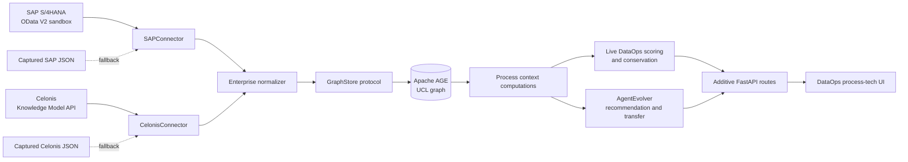

# D-CEL Design v1: Process-Tech Fusion for DataOps

**Status:** implementation specification  
**Scope:** DataOps copilot, SAP S/4HANA, Celonis Process Intelligence, and the UCL graph  
**Headline:** Celonis is the mirror. D-CEL adds the brain, hands, and memory.  
**Demo value:** $1.62M annual trajectory for the Continental Tire procure-to-pay scenario.

D-CEL means **DataOps Celonis + Enterprise Layer**. Celonis shows where process flow is slow. D-CEL combines that process state with SAP transactions, schema changes, alerts, decisions, learned patterns, and conservation state in the live context graph. The resulting product can explain why a bottleneck exists, estimate what it affects, recommend a governed fix, learn from the verified outcome, and transfer the pattern to another system.

This document specifies additive work. Existing DataOps routes and its five screens remain intact.

## 1. Architecture Overview

### 1.1 System shape



External systems are read-only evidence sources. Connectors fetch and validate source payloads; they do not write AGE directly. A DataOps-owned normalization and ingestion service converts valid payloads into process entities and relationships and persists them through the injected `GraphStore` protocol. Computations and endpoints read the graph-backed representation. Raw response snapshots are transport caches, not an application database or an alternate system of record.

### 1.2 Current-state reconciliation

The repository already contains useful D-CEL foundations. Implementation prompts must extend or consolidate these rather than introduce parallel implementations.

| Existing capability | Current location | D-CEL v1 action |
|---|---|---|
| Async SAP OData reads with sample fallback | `apps/dataops/backend/app/sap_connector.py` | Retain the public class; add bounded retry and five-minute TTL semantics. |
| Async Celonis Knowledge Model reads with sample fallback | `apps/dataops/backend/app/celonis_connector.py` | Retain the public class; add bounded retry and five-minute TTL semantics. |
| Request-keyed memory and disk snapshots | `apps/dataops/backend/app/connector_cache.py` | Evolve from once-per-process attempts to timestamped TTL entries and stale-on-error fallback. |
| Context connector health | `GET /api/context/enterprise-health` | Preserve for compatibility; make `GET /api/enterprise-health` the concise public contract. |
| Public health provider | `apps/dataops/backend/app/enterprise_health_provider.py` | Extend its additive response fields; do not create a third health implementation. |
| Enterprise fixture routes | `/api/dataops/enterprise-health`, `/api/dataops/process-summary`, `/api/dataops/sap-data` | Preserve as compatibility/demo routes while the new context contracts read GraphStore. |
| Basic process nodes and fixture manifests | DataOps `graph_contract.py`, `seed_graph.py`; `ci-platform/ci_platform/connectors/celonis.py` | Expand the contract to the complete process topology below and ingest via GraphStore. |
| Basic process timeline | `GET /api/context/process-timeline` | Preserve; add the system-scoped route and use the same response builder. |
| Process signals and cross-graph insight | `context_router.py` | Reuse as inputs to the richer computations; remove fixture-only computation paths during implementation only when parity is proven. |
| Process timeline and provenance badges | Existing frontend components | Enhance the existing components in place; the feature count below describes product capabilities, not duplicate files. |

### 1.3 `SAPConnector`

`SAPConnector` is an asynchronous, read-only OData V2 client. It supports:

- `API_PURCHASEORDER_PROCESS_SRV/A_PurchaseOrder`
- `API_SUPPLIERINVOICE_PROCESS_SRV/A_SupplierInvoice`
- `API_BUSINESS_PARTNER/A_BusinessPartner`
- `APIKey` request authentication, with the value supplied only through environment configuration
- `$format=json`, bounded `$top`, and nonnegative `$skip`
- strict OData V2 `d.results` validation before a response can enter the cache or graph
- a ten-second request timeout
- at most three attempts for transient connection, timeout, HTTP 429, and HTTP 5xx failures
- exponential backoff of 250 ms then 500 ms, with bounded jitter in production and injectable zero-delay timing in tests
- no retry for authentication, authorization, malformed response, or other permanent 4xx failures

The cache key includes connector identity without storing the credential itself, service path, and normalized query parameters. A successful validated response is fresh for five minutes. Concurrent identical requests coalesce behind one async lock. After TTL expiry, the connector tries the live endpoint. If the refresh fails, it may return the last valid captured response with `mode: "cache"`, `stale: true`, and the original capture timestamp. Checked-in sample JSON is the final fallback and is always labeled `provenance: "sample"`.

### 1.4 `CelonisConnector`

`CelonisConnector` is an asynchronous REST client for the Knowledge Model API. It supports:

- `GET /knowledge-models`
- `GET /knowledge-models/{id}/kpis`
- `GET /knowledge-models/{id}/data`
- bearer authentication supplied through environment configuration
- the same timeout, bounded retry, request coalescing, five-minute TTL, and stale-on-error policy as SAP
- strict separation between developer-portal sandbox data, customer data, captured responses, and checked-in samples

The connector preserves the raw selected fields and KPIs. It does not reinterpret event counts as durations or infer dollar savings. Normalization into `ProcessModel`, `ProcessVariant`, `Activity`, `Transition`, and `ProcessKPI` occurs after validation.

### 1.5 Health and operating modes

`GET /api/enterprise-health` is the public, lightweight readiness view. Each connector reports:

- `status`: `ok`, `degraded`, or `unavailable`
- `mode`: `live`, `cache`, or `sample`
- `latency_ms`: live request time or `null` when no network request occurred
- `last_success_at`: capture time of the response in use
- `stale`: whether the five-minute TTL has expired
- `provenance`: `sandbox`, `external`, or `sample`

`fusion_ready` is true when both connector payloads are valid and the GraphStore is readable. It does not imply that both connectors are live. Health calls must not relabel cached data as fresh or perform graph writes.

## 2. Process Nodes in the UCL Graph

### 2.1 Node contract

Every node has a stable domain-qualified ID, `domain: "dataops"`, source provenance, `source_record_id`, `observed_at`, `ingested_at`, and a payload schema version. Re-ingestion is idempotent by stable ID and observation version.

| Node | Required properties | Purpose |
|---|---|---|
| `ProcessModel` | `model_id`, `name`, `case_count`, `variant_count`, `source` | One Celonis knowledge/process model. |
| `ProcessVariant` | `variant_id`, `process_model_id`, `frequency`, `avg_duration`, `conformance_rate` | A measured execution path through a model. |
| `Activity` | `activity_id`, `name`, `duration`, `automation_rate`, `rework_rate` | A process step with measured operational behavior. Duration units are explicit. |
| `Transition` | `transition_id`, `from_activity_id`, `to_activity_id`, `frequency`, `wait_time`, `conformance` | A directed handoff between activities. Wait-time units are explicit. |
| `ProcessKPI` | `kpi_id`, `model_id`, `name`, `value`, `unit`, `window_start`, `window_end` | Celonis KPIs such as cycle time, on-time rate, and conformance rate. |
| `Supplier` | Existing supplier identity plus SAP business-partner provenance | Joins SAP commercial context to observed process behavior. |
| `PipelineSystem` | Existing system identity, criticality, owner, and downstream links | Anchors process flow in the DataOps dependency graph. |
| `SchemaChange` | Existing schema event identity, field, delta, timestamp, and source | Connects technical change to process degradation. |

### 2.2 Relationships

| Relationship | Direction | Properties |
|---|---|---|
| `HAS_VARIANT` | `ProcessModel` → `ProcessVariant` | rank, share of cases |
| `CONTAINS` | `ProcessVariant` → `Activity` | ordinal position |
| `TRANSITION_FROM` | `Activity` → `Transition` | none |
| `TRANSITION_TO` | `Transition` → `Activity` | none |
| `HAS_KPI` | `ProcessModel` → `ProcessKPI` | observation window |
| `BOTTLENECK_AT` | `Activity` → `PipelineSystem` | severity, detected_at, baseline_duration, current_duration |
| `TRIGGERED_BY` | `Activity` → `SchemaChange` | confidence, evidence IDs, temporal lag |
| `INVOICE_PATTERN` | `Supplier` → `Activity` | exception_rate, duration_ratio, invoice_count, window |

`Transition` remains a node because its frequency, wait time, and conformance are first-class evidence used by computations. Direct `FOLLOWS` edges may remain as a derived compatibility projection, but the transition node is canonical.

### 2.3 Persistence flow

1. The connector returns a validated envelope with explicit source and capture time.
2. The normalizer maps source fields to the versioned process contract and rejects missing IDs, invalid numbers, unknown units, and dangling references.
3. The ingestion service receives an injected `GraphStore`; no connector imports `AGEClient` or executes Cypher.
4. The service persists normalized process envelopes through a GraphStore-owned process-context capability. If the existing protocol lacks the required generic entity operation, D-CEL-2 extends the protocol and both approved implementations together, with conformance tests.
5. Cross-domain links use stable IDs already present in the DataOps graph. Missing link targets are reported as ingestion diagnostics rather than silently fabricated.
6. Endpoints read process context through GraphStore. Captured JSON is used only by the connector fallback and deterministic seed flow.

The design does not introduce SQLite, a connector-owned database, direct AGE access, or a second process system of record.

## 3. Computations Celonis Cannot Do Alone

Celonis supplies observed process state. D-CEL computations combine that state with the live context graph, verified outcomes, learned variants, and the existing scorer. Each result includes `evidence_ids`, `as_of`, `provenance`, and `mode` so the UI can distinguish measured facts, graph-derived conclusions, and modeled recommendations.

### 3.1 Bottleneck root cause

- **Input nodes:** `Activity`, incoming/outgoing `Transition`, `SchemaChange`, `Alert`, `PipelineSystem`, and recent verified `Decision` nodes.
- **Traversal:** start at the selected system; follow incoming `BOTTLENECK_AT` to the slow activity; compare its current duration and rework rate with the prior valid window; traverse `TRIGGERED_BY` to schema changes and temporally adjacent alerts; rank candidates by temporal proximity, affected-edge overlap, and corroborating alert count.
- **Output:** `{system, activity, current_duration, baseline_duration, root_cause, confidence, evidence_ids}`.
- **Demo expression:** `Caused by MATKL_V2`.

The computation must return `root_cause: null` when evidence is insufficient. It may not turn correlation into a causal statement without the configured evidence threshold.

### 3.2 Impact propagation

- **Input nodes:** bottleneck `Activity`, linked `PipelineSystem`, downstream system/dataset topology, criticality, active alerts, and SAP transaction counts.
- **Traversal:** follow `BOTTLENECK_AT` to the anchor system, then bounded downstream dependency edges with cycle detection and a maximum depth; aggregate distinct affected systems and classify critical systems from graph properties.
- **Output:** `{affected_systems, critical_systems, paths, transaction_exposure, evidence_ids}`.
- **Demo expression:** `7 systems, 3 critical`.

Counts come from distinct graph identities. Missing SAP records produce unknown transaction exposure, never zero inferred impact.

### 3.3 Supplier-process correlation

- **Input nodes:** `Supplier`, SAP purchase orders and invoices represented in graph context, `INVOICE_PATTERN`, `Activity`, and comparable supplier cohorts.
- **Traversal:** group verified exceptions by supplier and activity window; calculate supplier exception rate and median activity duration; compare with a minimum-size peer cohort over the same interval.
- **Output:** `{supplier, activity, exception_rate, duration_ratio, cohort_size, confidence, evidence_ids}`.
- **Demo expression:** `Aster 3.1x slower`.

The ratio is labeled unavailable until minimum sample and comparable-window checks pass.

### 3.4 Fix recommendation

- **Input nodes:** current bottleneck subgraph, similar historical alerts/decisions, centroid fingerprints, promoted evolution variants, verified outcomes, and conservation state.
- **Traversal:** build a situation fingerprint; query similar graph-backed cases; retain fixes with verified outcomes and matching causal features; rank by historical success, similarity, evidence quality, and current safety.
- **Output:** `{recommendation, historical_success_rate, similarity, confidence, expected_effect, conservation_preview, evidence_ids}`.
- **Demo expression:** `Pre-join filter (90%, 0.87)`.

The result uses the existing scoring and AgentEvolver services. It does not implement a second recommendation score in the connector layer.

### 3.5 Pattern transfer

- **Input nodes:** promoted AgentEvolver variant, source rule lifecycle, transfer artifact, target system context, target outcomes, and conservation snapshots.
- **Traversal:** follow the promoted pattern and its evidence to compatible target systems; validate the governed transfer artifact; observe target outcomes through the existing learning path; update lifecycle state only after verified evidence.
- **Output:** `{pattern_id, source_system, target_system, status, target_outcome, evidence_ids}`.
- **Demo expression:** `Auto-resolved at billing_api`.

### 3.6 Conservation-bounded automation

- **Input nodes:** current verified decision history, category coverage, rolling quality state, proposed automation rate, and the recommendation evidence.
- **Traversal:** invoke the existing live conservation service through the scorer-backed contract; compare the proposed action with the returned boundary; do not reimplement the formula in D-CEL.
- **Output:** `{status, current_automation, proposed_automation, theta_min, safe, reason, evidence_ids}`.
- **Demo expression:** `Safe at 72% auto-route`.

SAP and Celonis evidence contributes to the scored decision context and subsequent verified outcome. It does not bypass, override, or alter conservation math.

## 4. New Endpoints

All endpoints are additive and mounted by the existing DataOps application. Responses retain source provenance and tolerate live-to-cache fallback without changing shape.

### 4.1 `GET /api/enterprise-health`

Purpose: one concise status contract for the demo header and startup check.

```json
{
  "status": "ok",
  "sap": {"status": "ok", "mode": "live", "latency_ms": 184},
  "celonis": {"status": "ok", "mode": "live", "latency_ms": 126},
  "fusion_ready": true
}
```

The existing provider currently returns a connector list. D-CEL-1 adds the named `sap` and `celonis` objects while retaining the list during compatibility migration. HTTP 200 represents an intelligible health report even in cache mode; malformed configuration or an unreadable graph may use the repository's established degraded-health status behavior.

### 4.2 `GET /api/context/process-timeline/{system}`

Purpose: return the selected system's graph-backed process variant, activities, transitions, and bottleneck markers.

Response fields: `system`, `process_model`, `variant`, `activities`, `transitions`, `bottlenecks`, `root_cause`, `source`, `mode`, `as_of`, and `evidence_ids`. Activity duration and transition wait-time units are mandatory. The existing unscoped `/api/context/process-timeline` remains available and uses the same response builder with its current default selection.

### 4.3 `GET /api/context/sap-enrichment/{system}`

Purpose: expose the SAP context relevant to a pipeline system without returning an unbounded ERP dump.

Response fields: `system`, `purchase_order_summary`, `supplier_invoice_summary`, `suppliers`, `transaction_exposure`, `source`, `mode`, `as_of`, and `evidence_ids`. Default records are aggregates plus bounded identifiers needed for the demo. Sensitive or unused SAP fields are excluded by the normalizer.

### 4.4 `GET /api/context/process-kpis`

Purpose: merge measured Celonis KPIs with graph computations.

Response fields: `process_model`, `window`, `celonis_kpis`, `computed_metrics`, `conservation`, `source`, `mode`, `as_of`, and `evidence_ids`. `celonis_kpis` contains measured values such as cycle time, on-time rate, and conformance rate. `computed_metrics` contains root-cause confidence, propagated system count, supplier duration ratio, recommendation success, and eligible automation. Each metric carries its own `kind` of `measured`, `derived`, or `modeled`.

### 4.5 Endpoint behavior

- System and model identifiers are validated and encoded; unknown systems return the repository's normal 404 envelope.
- Endpoints do not trigger duplicate graph ingestion on every render. The application coalesces connector refresh and persists a new observation only when its source version or capture timestamp changes.
- A connector failure returns graph-backed last-known context with `mode: "cache"` when available. It does not silently replace external data with unlabeled fixture values.
- Application-level computation failures are visible as degraded fields with diagnostics; transport success does not imply a fabricated result.

## 5. Frontend Components

The current app has five screens: Dashboard, Triage, Insight, Evidence, and Curve. D-CEL adds three visible capabilities and enhances two existing panels without adding a sixth screen.

### 5.1 `ProcessTimelinePanel` — new capability

Enhance the existing component to call the system-scoped timeline route. It renders activities in order, transition wait time, measured duration, rework, automation rate, and bottleneck markers. Selecting a marker opens evidence for the root cause and downstream impact. Live, cache, and sample states remain visible. Empty and unavailable states do not show the Continental scenario as if it were measured live data.

Placement: Dashboard for Act 1 and Insight for Act 2.

### 5.2 `SAPDataBadge` — new capability

Enhance the existing badge to show `SAP live`, `SAP cached`, or `SAP sample`, plus the capture time. It reads provenance supplied by the relevant endpoint rather than making an independent health request for each row. The badge appears on transaction exposure, supplier correlation, and the enhanced schema-impact result.

### 5.3 `CelonisBadge` — new capability

Enhance the existing badge to show `Celonis live`, `Celonis cached`, or `Celonis sample`, plus the process model and capture time. It appears on timeline, bottleneck, and KPI views.

### 5.4 Enhanced `BottleneckPanel` (OE-2)

The panel retains its current transformation ranking and adds process activity, measured baseline/current duration, root cause, confidence, and expandable evidence. The headline for the demo is `Match Invoice to GR: 42 min; caused by MATKL_V2`. Celonis supplies the measured process state; the graph computation supplies the causal explanation.

### 5.5 Enhanced `SchemaImpactPanel` (OE-3)

The panel retains schema propagation and adds bounded SAP transaction exposure: affected purchase orders, supplier invoices, suppliers, and plant/system reach. It labels values as counts or currency and displays the SAP provenance badge. Unknown exposure remains unknown rather than being rendered as zero.

### 5.6 UI data flow

Dashboard fetches enterprise health once and passes connector state to badges. Selecting the process signal or alert establishes the active system. Triage loads SAP enrichment and the existing process signals in parallel. Insight loads the scoped timeline, KPIs, bottleneck root cause, and schema impact. Evidence continues to display learning and rule lifecycle; D-CEL adds source evidence IDs to those existing views.

## 6. Fallback Strategy

### 6.1 Priority order

1. **Live:** SAP sandbox and Celonis Developer Portal responses, validated and timed.
2. **Captured:** last valid response for the exact credential identity, URL, endpoint, and parameters.
3. **Sample:** checked-in, sanitized JSON with explicit `sample` provenance.
4. **Unavailable:** no valid source; return an empty/degraded contract without fabricated facts.

### 6.2 Five-minute cache policy

- Fresh entries are served for 300 seconds without a network call.
- At expiry, one caller refreshes while concurrent callers use the last valid entry or await the coalesced refresh according to endpoint policy.
- Successful refresh atomically replaces the captured snapshot and records its source timestamp.
- Failed refresh leaves the prior snapshot intact and reports `stale: true`.
- Cache files never contain API keys, bearer tokens, authorization headers, or raw customer credentials.

### 6.3 Demo sequence

At demo start, the operator calls `GET /api/enterprise-health`. This performs one live read per configured service, validates the response, records latency, and warms the five-minute cache. The remaining eight-minute demo reads the warm response and the graph-backed observation. If either live call fails, the health bar makes the cached or sample mode visible while the story remains deterministic.

This hybrid sequence proves a real connection once and avoids turning every screen transition into an external availability dependency.

## 7. Testing Strategy

### 7.1 Four spot E2E checks

1. **Enterprise health renders:** mocked live responses produce SAP and Celonis `live` badges and latency values; cached fixtures produce clearly labeled fallback states.
2. **Process timeline has data:** selecting `sap_mm` renders a process variant, ordered activities, and a bottleneck marker from the endpoint response.
3. **SAP badge is visible:** schema impact or enrichment renders the badge and the exact provenance/mode returned by the API.
4. **Celonis badge is visible:** the timeline/bottleneck panel renders the badge and capture time.

These are component-level browser tests with mocked network contracts. They do not require live SAP, Celonis, or AGE.

### 7.2 One flow E2E

The full flow is: enterprise health → Dashboard process signal → Triage with SAP enrichment → Insight with Celonis timeline/root cause → recommendation and conservation preview → verified outcome → Evidence rule lifecycle. Assertions cover the process-tech narrative, provenance continuity, and the absence of unlabeled fallback data.

### 7.3 Backend tests: approximately 21

| Area | Cases |
|---|---:|
| SAP connector parsing, auth header, pagination, validation | 4 |
| Celonis models, KPIs, data parsing, authorization, validation | 4 |
| Retry classification and bounded backoff | 2 |
| Five-minute TTL, request coalescing, stale-on-error, atomic snapshot | 4 |
| Enterprise-health response in live/cache/unavailable modes | 3 |
| Timeline, SAP enrichment, and KPI endpoint contracts | 3 |
| Graph node/edge creation, idempotency, and provenance | 1 parameterized group |

External HTTP clients may be mocked. Graph assertions use the real project GraphStore test implementation and protocol conformance path; no fake graph writes or direct AGE calls are introduced. Tests cover malformed and missing fixtures so fallback cannot turn invalid data into a healthy response.

### 7.4 Static verification

- Backend typecheck covers changed Python modules with the repository mypy configuration.
- Frontend typecheck: `npx tsc --noEmit`.
- Existing DataOps backend suite remains green.
- Existing frontend build and D-CEL panel smoke remain green.
- An import scan confirms no SOC imports, no `sqlite3`, no `SQLiteGraphStore`, and no DataOps connector import of `AGEClient`.

## 8. Demo Storyboard

The five acts run in about eight minutes. A short transition or audience pause accounts for the remaining time beyond the six minutes of scripted actions.

### Act 1 — WHERE (90 seconds)

Open **DataOps → Process Signals**. The enterprise health bar proves SAP and Celonis connectivity and shows the active mode. The process timeline highlights **Match Invoice to GR** at **42 minutes**. Celonis answers where the delay exists; no causal claim has been made yet.

### Act 2 — WHY (120 seconds)

Move from **Triage → Insight**. `BottleneckPanel` links the slow activity to the `MATKL_V2` schema change. `SchemaImpactPanel` shows **340K new material code combinations** and **9× fanout**, with SAP transaction exposure and provenance. The graph explains why the measured process state changed and where it propagates.

### Act 3 — WHAT (90 seconds)

Return to **Triage**. The AgentEvolver badge identifies the verified similar-case pattern. The recommendation is **Pre-join filter on MATKL_V2 range**. What-if changes the modeled activity time from **42 to 4 minutes**. Measured current state and modeled future state remain visually distinct.

### Act 4 — LEARN (60 seconds)

Use **Score → Confirm** to record the verified outcome. Show reward **+0.85**, conservation **GREEN**, and the resulting IKS movement. The outcome and learning state are persisted through the existing governed GraphStore path. The demo does not claim learning from an unverified click.

### Act 5 — TRANSFER (60 seconds)

Open **Evidence → Rule Lifecycle**. Show the pattern promoted from the source system and transferred through the governed artifact. The target result is **billing_api auto-resolved**. End on the distinction: Celonis exposed the bottleneck; D-CEL explained, acted, learned, and transferred.

## 9. Implementation Estimate

The estimates assume the existing prototype classes, fixtures, routes, and components are retained and consolidated.

| Prompt | Model / effort | Estimate | Deliverable and acceptance gate |
|---|---|---:|---|
| **D-CEL-1** | terra / medium | 0.5d | Consolidate `SAPConnector`, `CelonisConnector`, and `ConnectorCache`; add bounded retry, five-minute TTL, stale-on-error metadata, and the additive `/api/enterprise-health` contract. Connector and health tests pass. |
| **D-CEL-2** | terra / medium | 0.5d | Add the versioned process graph contract, GraphStore persistence path, idempotent ingestion, computations, and the three context endpoints. Real GraphStore tests prove nodes, relationships, provenance, and endpoint responses. |
| **D-CEL-3** | terra / medium | 0.5d | Enhance `ProcessTimelinePanel`, `SAPDataBadge`, `CelonisBadge`, `BottleneckPanel`, and `SchemaImpactPanel`; wire them into the existing five screens. Typecheck and frontend build pass. |
| **D-CEL-4** | terra / medium | 0.25d | Add four spot E2Es, one end-to-end demo flow, fallback integration checks, and deterministic demo warm-up documentation. Backend, frontend, and browser gates pass without live dependencies. |
| **D-CEL-REV** | sol / high | 0.25d | Review the full implementation against source contracts, GraphStore rules, provenance, conservation wiring, route compatibility, credential hygiene, test substance, and the storyboard. Any P1/P2 finding returns to the owning prompt. |

### Standing-rule verification

| Rule | Design result |
|---|---|
| **#29 — GraphStore is the storage abstraction** | PASS. Connectors return validated source envelopes. A service with an injected GraphStore owns process persistence and reads. No connector imports `AGEClient` or emits Cypher. |
| **#33 — Conservation uses live data** | PASS. SAP/Celonis context feeds the ordinary DataOps score and verified-outcome path. Automation calls the existing scorer-backed conservation service; no static conservation result or alternate formula is introduced. |
| **#35 — All platform data through GraphStore** | PASS. Process nodes, relationships, observations, recommendations, and verified outcomes live in GraphStore. JSON is limited to transport cache and deterministic samples. |
| **No SOC imports in DataOps** | PASS. The design depends on DataOps, SDK, and ci-platform contracts only. Cross-copilot transfer uses shared SDK interfaces. |
| **Fixture consistency** | PASS. The priority order extends the existing DataOps connector/sample pattern, preserves explicit provenance, and requires live and cached responses to normalize to one contract. |

The review gate must verify these claims against the implemented imports and data flow. A passing document review is not evidence that a future implementation complies.
