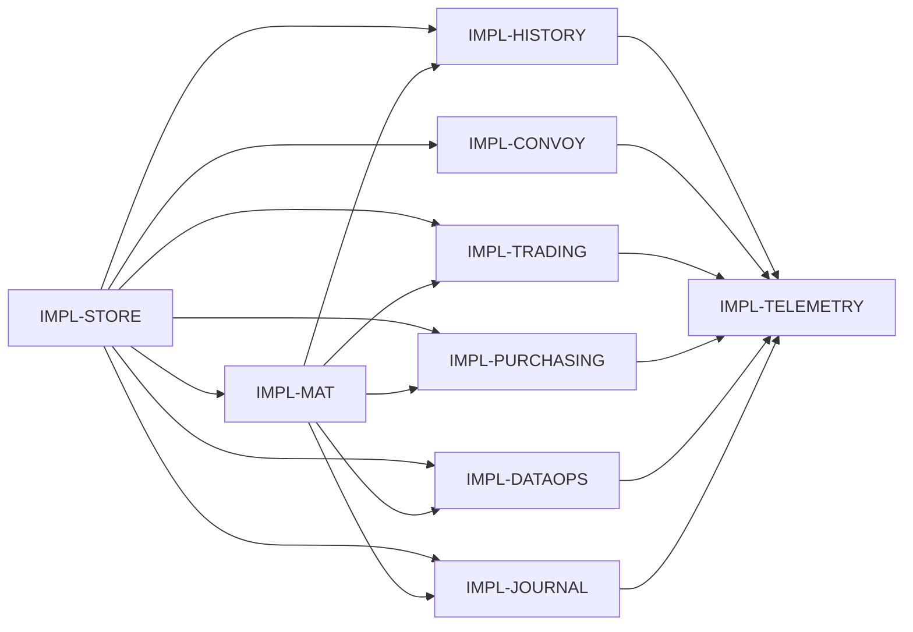

# Bounded Projection API for a Drift-Free SDK

**Status:** Ready for implementation  
**Date:** 2026-10-15  
**Source finding:** `REV-DRIFT-SDK-GAP`  
**Scope:** `copilot-sdk`, the three SDK applications, and the `ci-platform` AGE adapter/store  
**Constraint:** scorer math, learning, conservation laws, tensor dimensions, and canonical constants are frozen.

## 1. Problem statement

The current `GraphStore` interface makes bounded access awkward. It exposes bounded `get_decisions(...)`, but most consumers use `get_all_decisions()`, `get_verified_decisions(limit=None)`, or wrapper count methods that materialize rows and count them in Python. The production wrapper chain is:

```text
consumer
  -> TenantScopedGraphStore (when enabled)
  -> LegacySignalFilteringGraphStore
  -> AGEGraphStoreAdapter
  -> AGEGraphStore
```

`TenantScopedGraphStore` and `LegacySignalFilteringGraphStore` cannot express their visibility predicates to the raw store today. They therefore fetch extra rows, filter in Python, and sometimes fetch the complete domain. This defeats the bounded AGE methods even when the raw backend can already use Cypher `WHERE`, `ORDER BY`, `SKIP`, `LIMIT`, and `count(...)`.

The inventory for this design found **122 production call sites** under `copilot_sdk/` and `apps/` that invoke or delegate `get_all_decisions`, `get_verified_decisions`, `count_decisions`, `count_verified`, `count_correct`, or an equivalent complete-set access. The hot failures from `REV-DRIFT-SDK-GAP` are concentrated in materialization, score serialization, history, Trading regime/pre-score/journal, Purchasing control/auto-order, and DataOps display endpoints. The same interface is also used by startup, CLI, migration, reporting, and scorer replay paths.

This design adds four operations to the existing protocol. It does not introduce a second storage abstraction:

1. `query_decisions` — filtered, projected, cursor-paged rows.
2. `count_decisions` — the existing method extended with the same filter object.
3. `aggregate_decisions` — storage-side grouped counts and simple scalar aggregates.
4. `get_decision_changes` — a generation-stamped, cursor-paged change feed for incremental materialization.

`get_all_decisions()` remains available for compatibility, is marked deprecated, and is forbidden in new online request paths. Explicit export, backup, replay, and migration work must traverse `query_decisions` pages with a declared batch size and an explicit total-row budget.

`docs/session_state.md` is 1,027,368 bytes at design time. **session_state.md is at capacity; archive older entries before shipping implementation prompts.**

## 2. Bounded projection API

### 2.1 Shared types

The following types live beside `GraphStore` in `copilot_sdk/graph/protocol.py`. A separate `copilot_sdk/graph/query.py` module is acceptable only if `protocol.py` re-exports every public type so implementations have one canonical import path.

```python
from dataclasses import dataclass
from typing import Any, Literal

DecisionOrder = Literal["created_at", "verified_at"]
DecisionProjection = Literal["summary", "scoring", "journal", "full"]
DecisionGroup = Literal["category", "action", "status", "regime"]
DecisionMetric = Literal["count", "correct_count", "avg_confidence"]


@dataclass(frozen=True, slots=True)
class DecisionFilter:
    categories: tuple[str, ...] = ()
    actions: tuple[str, ...] = ()
    statuses: tuple[str, ...] = ()
    sources: tuple[str, ...] = ()
    regimes: tuple[str, ...] = ()
    ticker: str | None = None
    confidence_min: float | None = None
    confidence_max: float | None = None
    verified: bool | None = None
    correct: bool | None = None
    created_from: float | None = None
    created_to: float | None = None
    verified_from: float | None = None
    verified_to: float | None = None
    decision_ids: tuple[str, ...] = ()
    exclude_decision_ids: tuple[str, ...] = ()

    # Wrapper-injected storage predicates. Application callers must not
    # manufacture tenant IDs or disable compatibility visibility.
    tenant_id: str | None = None
    exclude_legacy_signals: bool = False


@dataclass(frozen=True, slots=True)
class DecisionCursor:
    order_by: DecisionOrder
    value: float
    decision_id: str


@dataclass(frozen=True, slots=True)
class DecisionPageRequest:
    limit: int = 100
    after: DecisionCursor | None = None
    offset: int = 0
    order_by: DecisionOrder = "created_at"
    descending: bool = True


@dataclass(frozen=True, slots=True)
class DecisionPageResult:
    items: tuple[dict[str, Any], ...]
    next_cursor: DecisionCursor | None
    has_more: bool


@dataclass(frozen=True, slots=True)
class DecisionAggregate:
    dimensions: dict[str, str]
    values: dict[str, int | float]


@dataclass(frozen=True, slots=True)
class DecisionChange:
    generation: int
    operation: Literal["upsert", "delete"]
    decision_id: str
    decision: dict[str, Any] | None
    # Retained on tombstones so tenant/legacy wrappers can filter deletes.
    routing: dict[str, str | bool | None]
    # Guaranteed keys: "tenant_id" (str | None), "legacy_signal" (bool),
    # "domain" (str). Wrappers rely on these for tombstone filtering.


@dataclass(frozen=True, slots=True)
class DecisionChangePage:
    changes: tuple[DecisionChange, ...]
    next_generation: int
    current_generation: int
    has_more: bool
    reset_required: bool = False
```

Validation is part of the contract:

- `DecisionPageRequest.limit` is 1–1,000.
- `offset` is 0–10,000 and cannot be combined with `after`. Offset exists for HTTP compatibility; internal loops use cursors.
- A cursor's `order_by` must match the request's `order_by`.
- ID include/exclude lists are capped at 500 values per call.
- Time ranges are inclusive at the lower bound and exclusive at the upper bound.
- Results always have a deterministic secondary order by `decision_id`.
- Stores fetch `limit + 1`, return at most `limit`, and derive `has_more` and `next_cursor` without a separate count.

### 2.2 Protocol methods

#### Method 1: filtered projected rows

```python
def query_decisions(
    self,
    domain: str,
    *,
    filters: DecisionFilter | None = None,
    projection: DecisionProjection = "summary",
    page: DecisionPageRequest | None = None,
    as_of_generation: int | None = None,
) -> DecisionPageResult: ...
```

`as_of_generation` anchors the query to a captured store generation for snapshot-consistent pagination during materializer cold-start reset. When set, the store returns only decisions whose last mutation generation is <= the given value. It cannot be combined with a cursor (`page.after`); the store raises `ValueError` if both are provided. Application callers must not set this parameter; it is used exclusively by the materializer cold-start path described in section 3.2.

The method returns decision dictionaries so existing consumers can migrate without a second domain model. The projection is nevertheless strict:

| Projection | Required fields | Intended users |
|---|---|---|
| `summary` | ID, domain, category, action, status, confidence, created/verified timestamps, correctness | history, health, counts requiring rows |
| `scoring` | summary plus factor vector, outcome, scores, learning metadata | scorer replay, conservation, IKS, pre-score |
| `journal` | summary plus ticker, regime, entry/exit time, price, quantity, P&L, tags/source | Trading journal |
| `full` | complete normalized decision and outcome | explicit backup/export/migration only |

AGE selects only projection fields. Arbitrary metadata remains available only in `full`. Fields that must be filtered or projected on hot paths—`tenant_id`, `legacy_signal`, `ticker`, `regime`, and journal timestamps—must be stored as canonical top-level properties on new writes. The implementation prompt includes an idempotent backfill for existing nodes. Cypher must bind values as parameters and construct only allow-listed property names and sort directions.

AGE query shape:

```cypher
MATCH (d:Decision)
OPTIONAL MATCH (d)-[:RESULTED_IN]->(o:Outcome)
WHERE d.domain = $domain
  AND <allow-listed filter predicates>
  AND ($as_of_generation IS NULL OR
       d.last_mutation_generation <= $as_of_generation)
  AND ($cursor_value IS NULL OR
       d.created_at < $cursor_value OR
       (d.created_at = $cursor_value AND d.decision_id < $cursor_id))
RETURN <projection fields>
ORDER BY d.created_at DESC, d.decision_id DESC
SKIP $offset
LIMIT $limit_plus_one
```

The comparison reverses for ascending order and uses `o.verified_at` for `verified_at` ordering. When `as_of_generation` is set, the cursor predicate is omitted and the materializer advances `page.offset` by the prior page size; all pages retain the same generation anchor. `InMemoryGraphStore` applies identical predicates and sorting to its in-memory snapshot, then slices. Python filtering is acceptable there because no remote rows are decoded.

#### Method 2: filtered count

```python
def count_decisions(
    self,
    domain: str,
    *,
    filters: DecisionFilter | None = None,
) -> int: ...
```

This is an extension of the existing protocol method, not a second count API. Its no-filter call remains source-compatible. AGE runs a Cypher `count(DISTINCT d)` with the same predicates as `query_decisions`; it never loads decision rows. `count_verified`, `count_verified_decisions`, and `count_correct` remain temporarily for compatibility and delegate to this method with `verified=True` or `correct=True`. They are deprecated after all callers migrate.

#### Method 3: grouped aggregates

```python
def aggregate_decisions(
    self,
    domain: str,
    *,
    filters: DecisionFilter | None = None,
    group_by: tuple[DecisionGroup, ...] = (),
    metrics: tuple[DecisionMetric, ...] = ("count",),
) -> tuple[DecisionAggregate, ...]: ...
```

Only the four allow-listed dimensions and three simple metrics are supported. AGE emits `WITH`/`RETURN` grouping and `count`/`avg`; it does not return source rows. In-memory uses one pass over a filtered generator. This method serves category/regime dashboards, accuracy totals, and governance projections without making the protocol a general query language.

When `group_by` is empty, `aggregate_decisions` returns a single `DecisionAggregate` with an empty `dimensions` dict and the requested metrics computed over all matching decisions. Callers that need only a scalar total count should prefer `count_decisions` for clarity and efficiency; `aggregate_decisions` with empty `group_by` is intended for callers that also need `correct_count` or `avg_confidence` in the same call.

#### Method 4: generation-stamped changes

```python
def get_decision_changes(
    self,
    domain: str,
    *,
    after_generation: int,
    limit: int = 1_000,
    projection: DecisionProjection = "full",
    filters: DecisionFilter | None = None,
) -> DecisionChangePage: ...
```

Every decision create, outcome verification/update, archive, and deletion increments a per-domain monotonic generation in the same durable transaction and records an upsert or tombstone. AGE stores a domain generation node and bounded `DecisionChange` records; the existing transaction/advisory-lock machinery protects the increment. Reads use `generation > $after`, the same tenant/legacy visibility predicates as normal reads, `ORDER BY generation, decision_id`, and `LIMIT $limit_plus_one`. Change records retain a small routing envelope (`tenant_id`, legacy flag, and domain) even for deletions so wrappers can filter tombstones without recovering the deleted node.

`InMemoryGraphStore` maintains a monotonic generation counter and an in-memory `list[DecisionChange]`. Every create, verify, update, archive, and delete appends a change record with the next generation. `get_decision_changes` filters and slices this list. This mirrors AGE semantics at the logical level and is the primary test surface for the change-feed contract suite (section 8.2).

The initial migration backfills one upsert change per existing active decision. Change retention may later compact acknowledged generations. If a caller's cursor predates the retained floor, the method returns `reset_required=True` and the current snapshot generation. The caller then rebuilds through bounded `query_decisions` pages with `as_of_generation=<captured generation>` and resumes the feed from that generation. This prevents a cold rebuild from mixing writes that arrive midway through pagination.

### 2.3 Wrapper behavior

Every wrapper implements and delegates all four methods. A wrapper may add predicates; it may not remove limits, fetch an unbounded superset, or count materialized rows.

| Layer | Required behavior |
|---|---|
| `TenantScopedGraphStore` | Copy the filter and inject the authenticated `tenant_id`; reject a conflicting caller-supplied tenant. Apply it to normal reads, counts, aggregates, and change-feed routing, while delegating cursor, projection, and `as_of_generation` unchanged. |
| `LegacySignalFilteringGraphStore` | Copy the filter and set `exclude_legacy_signals=True` for normal reads and change feeds. Delegate cursor, projection, and `as_of_generation` unchanged. The raw backend filters the canonical `legacy_signal` property/routing envelope. No wrapper paging loop or fixed-prefix over-fetch. |
| `GraphStoreNamespace` | Rewrite only `domain`, then delegate every other argument and result unchanged. |
| `AGEGraphStoreAdapter` | Translate SDK dataclasses to `AGEGraphStore` keyword arguments and normalize returned records. Do not post-filter. |
| `GraphStoreWrapper` | Provide pass-through implementations so future wrappers are protocol-complete by construction. |
| Dual-write/read-diff tooling | No active production DualWrite wrapper was found. Read-diff tools explicitly page both sides with the same filter/projection and compare page keys. Any future dual-write wrapper must delegate bounded reads to its authoritative read store. |

Composition is deterministic. For `TenantStore(LegacyFilter(AGE))`, the tenant wrapper injects `tenant_id`; the legacy wrapper adds `exclude_legacy_signals`; AGE receives both in one `DecisionFilter` and applies both in one Cypher `WHERE`.

### 2.4 Decisions on the five API questions

**Q1 — count method:** Extend the existing `count_decisions` protocol method with a keyword-only filter. Do not add a competing method. Compatibility aliases delegate to it.

**Q2 — return type:** Return normalized decision dictionaries through explicit lightweight projections. A new strongly typed decision hierarchy would widen this project beyond the latency fix. `full` remains bounded and opt-in.

**Q3 — cursor:** Ordinary reads use a composite `(sort timestamp, decision_id)` cursor. Checkpoint replay uses the existing verification cursor `(verified_at, decision_id)`. Materializer refresh uses a monotonic domain generation because wall-clock cursors cannot represent deletion and are vulnerable to late verification.

**Q4 — wrapper composition:** Wrappers copy and enrich a filter, then delegate once. They never page or expand independently. All storage-visible wrapper predicates have canonical indexed properties in AGE.

**Q5 — genuine all-row consumers:** No online HTTP consumer requires a single unbounded list. Backup, export, migration, replay, and read-diff use cursor pages with explicit batch and total-row budgets. A cold materializer reset uses generation-anchored offset pages because `as_of_generation` cannot be combined with `page.after`. `get_all_decisions` stays only for backward compatibility and tests during the deprecation window.

## 3. Materializer incremental refresh

The selected design is **generation-stamped incremental refresh**. Count-based refresh cannot identify updates/deletes and timestamp cursors can miss late outcomes. A monotonic mutation generation represents all state transitions.

### 3.1 Cached state

`ResponseMaterializer` keeps:

- `decisions_by_id: dict[str, dict[str, Any]]` containing the last complete normalized record for each active decision.
- `verified_ids: set[str]` derived from merged outcome status.
- `store_generation: int` through which the cache is complete.
- The existing atomically published response generation: fingerprint, trajectory, conservation, measurement state, and registered app payloads.
- Refresh timing, query/row counters, failure state, and mutation-pending state.

Refresh works on private copies and publishes the state maps and response payloads together. It never holds the materializer condition lock during graph I/O or payload computation.

### 3.2 Cold start and reset

1. Call `get_decision_changes(after_generation=0, limit=1_000)` and consume pages.
2. If the complete history is retained, apply all upserts/tombstones to the private map.
3. If `reset_required`, set `captured_gen = current_generation`, page `query_decisions(domain, projection="full", page=DecisionPageRequest(limit=1_000, offset=...), as_of_generation=captured_gen)` by increasing `offset` until exhaustion, and anchor the cache at that generation. This internal reset path does not set `page.after`.
4. Re-read changes after the anchor so writes that committed after the captured generation are applied.
5. Compute every registered response from that one shared local snapshot and publish atomically.

Cold start is bounded per query, but may require several background pages. Until the first complete generation exists, cache-backed endpoints return `503 Service Unavailable` with `Retry-After: 1`; they never fall through to a live full scan.

### 3.3 Normal refresh

1. Read changes after `store_generation` in batches of 1,000.
2. Apply upserts and tombstones to private state.
3. If no changes exist, renew the response-generation timestamp without recomputing payloads.
4. If changes exist, recompute all registered responses from the updated local state and atomically publish.
5. Clear `mutation_pending` only after the published generation includes the mutation's target store generation.

The score/learn persistence transaction increments the store generation. Its post-commit hook calls mutation-strength invalidation and passes that target generation. This preserves the current rule that a pre-mutation generation cannot be served after mutation.

Checkpoint restore changes scorer process state, not graph decision state, and therefore does not advance the store generation. If a restore job writes or archives graph records, those normal mutations generate change events.

### 3.4 Failure behavior

- A TTL refresh failure with no pending mutation serves the last good generation and retries in the background with bounded exponential backoff capped at 30 seconds.
- A refresh failure while `mutation_pending` does not serve the known pre-mutation generation. The endpoint returns `503` with `Retry-After: 1` while the materializer retries.
- A cold-start failure also returns `503`.
- Direct scorer/store fallbacks are removed from trajectory, measurement-state, conservation, fingerprint, and other registered cache-backed display reads. This closes P2-7 rather than hiding a cache outage behind another unbounded scan.
- Debug status exposes store generation, published generation, backlog, reset state, last error, retry delay, query count, row count, and refresh duration.

## 4. Score convoy budget

Prediction remains outside the mutation lock and scorer math remains unchanged. The budget wraps the current ordering and persistence operations.

### 4.1 Fixed budgets

| Phase | Budget |
|---|---:|
| Total server-side score request | 8.0 s |
| Prediction outside mutation lock | 2.0 s |
| Per-domain mutation lock acquisition | 1.0 s |
| Waiter capacity per domain | 8 requests |
| Pool acquisition while lock is held | 1.0 s |
| Durable statement/transaction while lock is held | 3.5 s |
| Invalidation, serialization, and response reserve | 0.5 s |

The 8-second server budget remains below the 10-second endpoint contract. A request carries a monotonic deadline. Each phase receives `min(phase_budget, remaining_budget)`; no child timeout may extend the request deadline or the existing database statement timeout.

### 4.2 Overload behavior

- If eight requests already wait for a domain, reject the next request immediately.
- If lock acquisition exceeds one second, return `503 Service Unavailable`, `Retry-After: 1`, and a stable body such as `{"error": "score_busy", "retryable": true}`.
- If pool acquisition or durable execution exhausts its sub-budget, roll back and return the same retryable 503. Never learn from or acknowledge a write that did not commit.
- If the prepared prediction is stale when the lock is acquired, use the existing correctness path. Re-predict only when the remaining request budget is sufficient; otherwise reject before persistence. This changes scheduling, not prediction or learning math.

`DomainMutationLockRegistry` owns the deadline-aware acquisition and waiter counter. The AGE client accepts the remaining pool/statement budget through a request context object or explicit transaction options. No sleeps are used in tests.

### 4.3 Convoy tests

Use thread events/barriers to hold the first request inside the lock, start a second request, and assert that the second returns the retryable 503 within the lock budget while the first is still blocked. Separate tests cover waiter-cap rejection, pool timeout rollback, no learn after failed persistence, and successful recovery on retry.

## 5. Journal predicate pushdown

Trading journal processing changes from “load, normalize, overlay, sort, parse, filter” to:

```text
parse query
  -> compile safe DecisionFilter
  -> query bounded journal projection
  -> apply remaining Python predicates
  -> overlay and deduplicate manual entries
  -> merge-sort and page
```

### 5.1 Predicates pushed to AGE

- Category/categories.
- Action when the parsed query names one.
- Created/entry date lower and upper bounds.
- Exact normalized ticker.
- Regime.
- Verified/unverified status.
- Minimum confidence when expressed by supported syntax.

Ticker, regime, and journal timestamps must be canonical top-level AGE properties before these predicates are enabled. Existing metadata JSON is not treated as a queryable index. The store implementation prompt includes write-path population and an idempotent backfill.

### 5.2 Predicates retained in Python

- Manual-entry overlay and deletion/tombstone overlay.
- Cross-source deduplication.
- Free-text terms and unsupported natural-language concepts.
- Factor-vector conditions, tag combinations, P&L/win-loss calculations, and any predicate derived from manual fields.

The Python phase operates on bounded journal pages. If a residual predicate underfills a page, the Trading helper follows `next_cursor` until it fills the requested page, reaches exhaustion, or hits a declared scan budget of 2,000 graph rows (5x the standard q=400 decision window, capping journal-scan latency below 500ms on the AGE benchmark cluster). A budget hit is surfaced as `truncated=true` plus an existing warning channel; it does not silently claim an exhaustive result.

### 5.3 Pagination

The journal helper uses `query_decisions(..., projection="journal")`. Its public cursor encodes the graph cursor and manual-entry position. It performs a deterministic merge by `(entry_time, trade_id)`, applies tombstones, and emits the next composite cursor. Existing offset parameters remain capped compatibility inputs and are translated by bounded iteration; new callers use the cursor.

Counts use `count_decisions` with the pushed filter, then adjust for the small manual overlay and known duplicate IDs. The list endpoint never fetches the complete graph to slice in Python.

This helper is Trading-specific and composes the shared API. No journal-specific method is added to `GraphStore`.

## 6. Query budget telemetry

### 6.1 Collection

A lightweight `GraphQueryBudget` object is installed in a `ContextVar` by FastAPI/ASGI middleware for each HTTP request. It records:

- `graph.query.count`
- `graph.rows.decoded`
- `graph.bytes.decoded`
- `graph.pool.wait_ms`
- `graph.execution_ms`
- `graph.serialization_ms`
- `graph.budget.endpoint`
- `graph.budget.exceeded`

`AGEClient` records pool wait and execution time. `AGEGraphStore`/adapter records decoded rows, normalized byte size, and serialization time. The byte metric is the UTF-8 size of the normalized JSON-compatible result, so it is deterministic across tests. `InMemoryGraphStore` records logical calls and returned rows. Wrappers annotate logical operation names but do not increment transport query count, preventing double counting.

### 6.2 Emission

At response completion the middleware emits one structured `[GRAPH_BUDGET]` log record. If an OpenTelemetry span is already active, it also sets the same attributes without adding a dependency. A bounded in-process rolling snapshot backs debug diagnostics; it is not a correctness mechanism and does not change responses.

### 6.3 Test enforcement

Tests install a capture sink and use:

```python
with assert_graph_budget(max_queries=2, max_rows=1_100):
    response = client.get("/api/trajectory")
```

Initial materializer construction may use multiple bounded pages and has its own explicit cold-start budget. A fresh-generation display hit must issue zero graph queries. Suggested endpoint budgets are:

| Endpoint class | Maximum graph queries after warmup |
|---|---:|
| Materialized display (`trajectory`, fingerprint, conservation, measurement) | 0 |
| History page | 2 (page plus exact count) |
| Score | 1 governed write transaction |
| Trading journal page | 1 per source page, maximum fixed by 2,000-row scan budget |
| Regime/category dashboard | 1 aggregate query |

Telemetry observes and tests budgets; it does not reject production requests.

## 7. Consumer migration map

The inventory below is definitive for production Python under `copilot_sdk/` and `apps/` as of 2026-10-15. Names are `file: function(s)`. Multiple calls inside one function count once. The total is **122 sites**.

| Group | Sites | Current need | New operation | Prompt |
|---|---:|---|---|---|
| Store/wrappers | 23 | Delegation, visibility filtering, wrapper counts | Delegate `query_decisions`, filtered `count_decisions`, `aggregate_decisions`, change feed | IMPL-STORE |
| SDK backend | 15 | Materialized display snapshots, history, health, switching/transfer counts | Change feed; bounded `summary`/`scoring` pages; filtered counts/aggregates | IMPL-MAT, IMPL-HISTORY |
| Scoring core | 19 | Verified windows, replay, checkpoint quality, IKS/conservation counts | `scoring` pages with verification cursor; filtered counts/aggregates | IMPL-HISTORY |
| Trading | 21 | Pre-score, regime, analytics, journal, promotion, CLI/startup | Bounded scoring/journal pages and aggregates | IMPL-TRADING, IMPL-JOURNAL |
| Purchasing | 19 | Auto-order, controls, evidence, trust, PAR, startup/CLI | Category/verified pages and aggregates | IMPL-PURCHASING |
| DataOps | 11 | Context/display timelines, RSI, schema/source trust, startup | Projected pages and grouped aggregates | IMPL-DATAOPS |
| Other SDK | 8 | Demo restore, DI/reporting/outcome/transfer | Bounded pages; explicit page traversal for restore | IMPL-HISTORY |
| Migration tools | 6 | Verification/rehearsal/shadow coverage | Explicit full page traversal or aggregate | IMPL-HISTORY |

The hot-path assignments preserve the finding IDs used by `REV-DRIFT-SDK-GAP`:

| Gap | Affected path | Owning prompt |
|---|---|---|
| P1-1 | Materializer full decision and verified scans | IMPL-MAT |
| P1-2 | Unbounded score lock wait and persistence convoy | IMPL-CONVOY |
| P1-3 | History/request paths that read or count complete sets | IMPL-HISTORY |
| P1-4 | Trading pre-score and regime full scans | IMPL-TRADING |
| P1-5 | Trading journal load-before-parse/filter | IMPL-JOURNAL |
| P1-6 | Purchasing auto-order/control full scans | IMPL-PURCHASING |
| P2-1 | Remaining Trading display/analytics scans | IMPL-TRADING |
| P2-2 | DataOps display scans | IMPL-DATAOPS |
| P2-3 | Wrapper/history count expansion | IMPL-HISTORY and IMPL-STORE |
| P2-4 | Remaining Purchasing projections | IMPL-PURCHASING |
| P2-6 | Missing universal graph-query budget telemetry | IMPL-TELEMETRY |
| P2-7 | Materializer refresh failure falling through to live reads | IMPL-MAT |

### 7.1 Store/wrapper sites — 23

**Gap assignment for every site in this subsection:** P2-3 (wrapper/count expansion), with IMPL-STORE providing the shared prerequisite for P1-1 through P1-6.

- `copilot_sdk/graph/legacy_signal_filter.py`: `_count`, `get_all_decisions`, `save_centroids` — replace internal materialization with filter delegation/count; explicit checkpoint lookup uses a bounded ID query.
- `copilot_sdk/graph/memory_store.py`: `_contextual_judgment_with_view`, `_query_similar_with_view`, `count_verified`, `save_centroids` — reuse the shared in-memory predicate engine; checkpoint lookup is bounded by IDs.
- `copilot_sdk/graph/namespace.py`: six decision/count delegation methods — add direct delegation for all four operations and keep old aliases.
- `copilot_sdk/graph/outcome_service.py`: `_commit` — replace post-write complete-set checks with ID query/count.
- `copilot_sdk/graph/projection.py`: `get_category_breakdown`, `get_profile_snapshot` — route through `aggregate_decisions` and filtered counts; deprecate this separate direct-AGE read surface after migration.
- `copilot_sdk/graph/read_diff.py`: `_compare_active` — page both stores with matching cursors and a declared comparison cap.
- `copilot_sdk/graph/tenant_store.py`: `count_correct`, `count_decisions`, `count_verified`, `count_verified_decisions`, `get_all_decisions`, `get_verified_decisions` — inject tenant filter and delegate rather than load/filter.

### 7.2 SDK backend sites — 15

**Gap assignment for every site in this subsection:** P1-1/P2-7 for materializer and cache-backed display paths; P1-3/P2-3 for history, health, self-computation, switching-cost, and transfer reads.

- `copilot_sdk/backend/conservation_utils.py`: `_baseline_q`, `_state_verified_decisions`, `state_counts` — scoring projection and filtered counts/aggregate.
- `copilot_sdk/backend/health_builder.py`: `build_graph_health` — filtered counts only.
- `copilot_sdk/backend/response_materializer.py`: `refresh` — `get_decision_changes`.
- `copilot_sdk/backend/scoring_router.py`: `history` — one summary page plus filtered count.
- `copilot_sdk/backend/self_computation_router.py`: `_count_correct`, `_count_verified`, `_get_all_decisions`, `_get_verified_decisions`, `_verified`, `decisions` — counts, aggregates, and bounded scoring pages.
- `copilot_sdk/backend/switching_cost_router.py`: `_decision_count`, `_decision_records` — count plus bounded summary/scoring page.
- `copilot_sdk/backend/transfer_router.py`: `_pattern_dollar_impact` — filtered aggregate or bounded scoring page.

### 7.3 Scoring-core sites — 19

**Gap assignment for every site in this subsection:** P1-3/P2-3. These are bounded replay, verified-window, and count dependencies; no scorer-math finding is included.

- `copilot_sdk/scoring/composite_gate.py`: `outcomes_from_state` — bounded verified scoring window.
- `copilot_sdk/scoring/gate_enforced_scorer.py`: `_get_recent_outcomes` — recent verified scoring page.
- `copilot_sdk/scoring/iks.py`: `_verified_decisions` — aggregate plus bounded verified projection.
- `copilot_sdk/scoring/measurement.py`: `_verified_decisions` — bounded verified projection.
- `copilot_sdk/scoring/scorer.py`: `_checkpoint_quality`, `_compute_iks`, `_conservation_stats`, `_maybe_archive`, `_run_evolution`, `_save_centroids_checkpoint`, `_verified_decisions`, `capture_existing_state`, `export`, `from_preset`, `get_alpha`, `get_phase`, `get_verified_count`, `trajectory` — filtered counts/aggregates, bounded verified replay pages, and explicit full page traversal only for export/bootstrap.
- `copilot_sdk/scoring/trust_traps.py`: `_verified_decisions` — bounded verified projection.

### 7.4 Trading sites — 21

**Gap assignment for every site in this subsection:** P1-4/P2-1, except the journal site, which is P1-5.

- `apps/trading/backend/app/cli.py`: `_counts`, `export_sdk`, `journal_sdk` — counts and explicit paged export/journal projection.
- `apps/trading/backend/app/context.py`: `_analytics_from_store` — aggregates.
- `apps/trading/backend/app/main.py`: `_auto_seed_if_needed`, `_run_startup_locked`, `clone_fingerprint` — counts, bounded ID/summary reads, materialized fingerprint.
- `apps/trading/backend/app/services/analytics.py`: `_verified_decisions` — bounded scoring page/aggregate.
- `apps/trading/backend/app/routers/claim_gate_router.py`: `claim_gate` — filtered count/aggregate.
- `apps/trading/backend/app/routers/execution.py`: `_trades` — journal projection page.
- `apps/trading/backend/app/routers/journal.py`: `_journal_records` — Trading journal helper described in section 5.
- `apps/trading/backend/app/routers/promotion.py`: `_conservation_status` — materialized conservation payload.
- `apps/trading/backend/app/routers/regime_analytics.py`: `_read_decisions` — regime aggregate and bounded scoring page.
- `apps/trading/backend/app/services/claim_gate.py`: `refresh_from_store` — filtered aggregate.
- `apps/trading/backend/app/services/pre_scorer.py`: `_all_decisions`, `_verified_decisions` — one bounded scoring window plus aggregate counts.
- `apps/trading/backend/app/services/promotion_engine.py`: `_category_decisions` — category-filtered scoring page.
- `apps/trading/backend/app/services/regime_classifier.py`: `_verified_decisions` — verified category/regime projection.
- `apps/trading/backend/app/services/trader_profiles.py`: `_verified_decisions` — verified aggregate/page.
- `apps/trading/backend/app/compute_helpers.py`: `compute_all_decisions`, `count_decisions` — projected page and filtered count.

### 7.5 Purchasing sites — 19

**Gap assignment for every site in this subsection:** P1-6/P2-4.

- `apps/purchasing/backend/app/main.py`: `_auto_seed_if_needed`, `_graph_order_rows`, `predictive_par`, `predictive_par_week` — counts and bounded category/order projections.
- `apps/purchasing/backend/app/routers/auto_order_router.py`: `_category_verified_decisions`, `_store_for_state` — category+verified scoring page and counts.
- `apps/purchasing/backend/app/routers/evidence.py`: `_all_decisions`, `_verified_decisions` — bounded evidence projection/count.
- `apps/purchasing/backend/app/routers/iks.py`: `_supplier_rows_from_graph` — supplier/category projection.
- `apps/purchasing/backend/app/routers/learning_beats.py`: `_verified` — verified scoring window.
- `apps/purchasing/backend/app/routers/regime.py`: `_payload` — grouped aggregate.
- `apps/purchasing/backend/app/routers/scorecard.py`: `_verified_decisions` — verified scoring page.
- `apps/purchasing/backend/app/routers/trust.py`: `_decisions_total` — count.
- `apps/purchasing/backend/app/routers/verify.py`: `_already_verified` — decision-ID query.
- `apps/purchasing/backend/app/services/purchasing_control.py`: `_decisions`, `_verified`, `refresh` — category/verified pages and aggregates.
- `apps/purchasing/backend/app/cli.py`: `backup`, `conservation` — explicit bounded full traversal and aggregate/count.

### 7.6 DataOps sites — 11

**Gap assignment for every site in this subsection:** P2-2.

- `apps/dataops/backend/app/context_router.py`: `_graph_decisions`, `accuracy_by_category`, `pipelines`, `process_timeline`, `rsi_summary`, `schema_impact`, `transformations` — bounded context projections and grouped aggregates.
- `apps/dataops/backend/app/main.py`: `_auto_seed_if_needed` — count.
- `apps/dataops/backend/app/routers/di_gateway.py`: `verification_history` — recent verified summary page.
- `apps/dataops/backend/app/routers/regime.py`: `_payload` — grouped aggregate.
- `apps/dataops/backend/app/services/source_trust.py`: `compute_source_trust` — source-filtered aggregate/page.

### 7.7 Other SDK sites — 8

**Gap assignment for every site in this subsection:** P1-3/P2-3 because these consumers repeat the same unbounded projection/count pattern outside the primary routers.

- `copilot_sdk/demo/bundle.py`: `_restore` — explicit bounded full traversal for comparison/restore.
- `copilot_sdk/di/enrichment.py`: `_read_verified_decisions` — verified projection page.
- `copilot_sdk/di/nl.py`: `_decisions` — bounded summary page.
- `copilot_sdk/di/query_providers.py`: `_decisions` — bounded requested projection.
- `copilot_sdk/outcome/router.py`: `count` — filtered count.
- `copilot_sdk/reporting/weekly.py`: `generate`, `_window_verified` — verified date-window projection and aggregate.
- `copilot_sdk/transfer/cross_domain.py`: `insights` — bounded per-domain aggregate/page.

### 7.8 Migration/tooling sites — 6

**Gap assignment for every site in this subsection:** P2-3. These are offline paths, so their implementation uses explicit page and total-row budgets rather than endpoint latency limits.

- `copilot_sdk/migration/shadow_scorer.py`: `_category_coverage_alpha` — category aggregate.
- `copilot_sdk/migration/verify_state.py`: `count_correct`, `count_verified`, `count_verified_decisions`, `replay_decisions` — counts and cursor-paged scoring replay.
- `copilot_sdk/migration/rehearsal.py`: `_existing` — bounded ID/full page traversal with an explicit cap.

## 8. Test strategy

### 8.1 Protocol contract suite

Create a parameterized contract suite for every GraphStore implementation/wrapper. Populate known decisions spanning tenants, legacy markers, categories, actions, statuses, dates, verification dates, correctness, ticker, and regime. For every supported filter/projection/order:

- Compare bounded results to a test-only Python filter of the complete fixture.
- Verify cursor pages concatenate to the same deterministic order with no duplicates or omissions.
- Verify `limit + 1` has correct `has_more` behavior.
- Verify count and aggregate results without invoking row-returning methods.
- Verify wrapper composition sends one combined filter to the delegate.
- Verify old signatures still work during deprecation.

`InMemoryGraphStore`, `LegacySignalFilteringGraphStore`, `TenantScopedGraphStore`, `GraphStoreNamespace`, and the AGE adapter all run the contract. AGE integration tests live in `ci-platform/tests`; use the existing AGE fixture when available and a query-capturing client otherwise. The latter must assert generated Cypher contains predicate, deterministic order, and `LIMIT`, rather than merely asserting returned mocks.

### 8.2 Change-feed/materializer tests

- Create, verify, update, archive, and delete decisions; assert ordered generation changes and tombstones.
- Cold build from generation zero.
- Compacted-feed reset through `as_of_generation` snapshot pages, including a concurrent mutation after the captured generation.
- One incremental refresh reads only new changes and produces payloads identical to a full test-only recomputation.
- Fresh generation causes zero graph queries.
- TTL failure serves last good generation; mutation-pending failure returns 503 and never calls a direct full-read fallback.
- Existing concurrency tests continue to prove one refresh, stale TTL serving, and mutation-safe publication.

### 8.3 Consumer equivalence tests

For every migration group, seed a fixed store and compare the migrated output to the pre-migration logic implemented inside the test as a pure fixture oracle. Tests verify response shapes as well as values. High-value fixtures include mixed tenants, legacy decisions, late verification, archived rows, manual journal overlays, empty categories, and more than one storage page.

### 8.4 Convoy and deadline tests

Use events/barriers and a fake monotonic clock. Assert lock-acquisition timeout, waiter cap, remaining-budget propagation, database rollback, no learn after persistence failure, and retry success. No sleep-based timing assertions.

### 8.5 Telemetry tests

- Fresh materialized display: zero graph queries.
- Cold/incremental materializer: bounded page/query count and accurate rows.
- History: at most two queries and at most requested rows plus lookahead.
- Aggregate dashboard: one query and aggregate rows only.
- Score: one governed transaction and recorded pool wait/execution time.
- Wrapper calls do not double-count transport queries.

### 8.6 Regression policy

All existing SDK, Trading, Purchasing, DataOps, and `ci-platform` tests remain green after every prompt. New API methods are additive. Deprecation warnings must not fail existing callers until their migration prompt lands. Scorer benchmark values remain frozen; implementation reviews must diff scorer math separately from fetch-path changes.

## 9. Implementation prompt sequence

The sequence contains nine prompts and has no dependency cycle:



Test deltas are planning targets, not permission to reduce coverage if implementation exposes more cases.

| Prompt | Reads | Changes | Expected tests | Depends on | Model / time |
|---|---|---|---:|---|---|
| **IMPL-STORE** | This document; `graph/protocol.py`, `production.py`, `memory_store.py`, `legacy_signal_filter.py`, `tenant_store.py`, `namespace.py`, `factory.py`, `projection.py`; AGE store/adapter and their tests | Those protocol/implementation/wrapper files; AGE schema/write/backfill code; contract tests | +30 | none | Sol high, 2–3 h |
| **IMPL-MAT** | This document; `backend/response_materializer.py`, scoring/conservation routers; materializer setup in Trading/Purchasing/DataOps mains | Materializer/change-feed integration, app registrations, removal of live display fallbacks, materializer tests | +10 | IMPL-STORE | Sol high, 1.5–2 h |
| **IMPL-HISTORY** | This document; `backend/scoring_router.py`, `self_computation_router.py`, `switching_cost_router.py`, `transfer_router.py`, `health_builder.py`, `conservation_utils.py`; scoring/reporting/DI/migration sites in section 7 | Those consumers and focused tests; no scorer math | +18 | IMPL-STORE, IMPL-MAT | Sol high, 2–3 h |
| **IMPL-TRADING** | This document; Trading sites in section 7.4 except journal; existing backend tests | `pre_scorer.py`, regime/analytics/claim/promotion/profile/context helpers, bounded startup/CLI reads, tests | +14 | IMPL-STORE, IMPL-MAT | Sol high, 2–3 h |
| **IMPL-PURCHASING** | This document; all section 7.5 sites and materializer setup | Auto-order/control/evidence/IKS/regime/scorecard/trust/verify/PAR/startup/CLI bounded reads, tests | +14 | IMPL-STORE, IMPL-MAT | Sol high, 2–3 h |
| **IMPL-DATAOPS** | This document; all section 7.6 sites and materializer setup | Context/display/regime/source-trust/startup bounded reads, tests | +10 | IMPL-STORE, IMPL-MAT | Sol high, 1.5–2 h |
| **IMPL-CONVOY** | This document; `scoring/mutation_lock.py`, score path in `backend/scoring_router.py`, AGE pool/transaction timeout code | Deadline-aware lock/waiter mechanism, budget propagation, deterministic concurrency tests | +10 | IMPL-STORE | Sol high, 1.5–2 h |
| **IMPL-JOURNAL** | This document; `services/journal_query.py`, `routers/journal.py`, journal section of Trading `main.py`, AGE journal fields | Those three Trading files, canonical journal-field write/backfill if not completed by STORE, journal tests | +12 | IMPL-STORE, IMPL-MAT | Sol high, 1.5–2 h |
| **IMPL-TELEMETRY** | This document; GraphStore implementations/wrappers, AGE client/store, app middleware setup, migrated endpoint tests | New `copilot_sdk/graph/query_budget.py`, AGE instrumentation, middleware wiring in three SDK apps, budget helpers/tests | +14 | all eight earlier prompts | Sol high, 1.5–2.5 h |

Recommended delivery order is STORE; then MAT and CONVOY (parallel); then HISTORY and the four app migrations (parallel, after MAT lands); then TELEMETRY. Independent prompts in a tier may be implemented in separate worktrees, but protocol changes must land first and telemetry budgets must be calibrated only after every consumer migration.

## 10. Open questions and risks

1. **AGE indexes and backfill.** Before enabling tenant, legacy, ticker, regime, and journal filters, confirm and create indexes supported by the deployed AGE/PostgreSQL versions. Backfill must be idempotent and measurable. Until it completes, wrappers must fail closed or use a bounded compatibility page loop with an explicit cap; they must not revert to an unbounded read.
2. **Change-log retention.** Initial implementation should retain all change records until cold-reset and acknowledgement behavior are proven. A later retention policy needs a retained-floor marker and reset test before deletion is enabled.
3. **Materializer memory.** Incremental reads remove repeated graph scans but keep a local map. The current scorer archive policy normally bounds active decisions; production diagnostics must still report map size and warn at a configured ceiling. A future streaming aggregate materializer is separate work.
4. **Exact counts with manual overlays.** Journal graph counts are exact, but cross-source dedup can change the combined count. Manual data is small enough to reconcile in Python; tests must cover collisions.
5. **S2P and SOC compatibility.** The 122-site inventory follows the requested `copilot_sdk/` and `apps/` scope. The shared protocol is also consumed by sibling repositories. IMPL-STORE must run an import/signature audit against S2P and SOC and preserve additive defaults. The IMPL-STORE pre-check must run:

   ```bash
   grep -rn "get_all_decisions\|count_decisions\|get_verified" \
     ../s2p-copilot/ ../gen-ai-roi-demo-v4-v50/ --include="*.py" \
     | grep -v __pycache__ | grep -v test
   ```

   If hits are found, record them in a new subsection 7.9 (sibling repos) of this design document with prompt assignment TBD. Do not migrate them in IMPL-STORE.
6. **Checkpoint semantics.** The existing `(verified_at, decision_id)` cursor remains the source of truth for replay selection. The materializer generation is not substituted into scorer checkpoint state.
7. **Projection evolution.** Projection field sets are versioned in code and additive within a release. Consumers cannot request arbitrary property names, which avoids Cypher injection and accidental wide rows.
8. **Deprecated API removal.** `get_all_decisions` and specialized count aliases can be removed only after a repository-wide grep, sibling audit, and at least one full release with deprecation telemetry showing zero production calls.

## Acceptance checklist

- All 122 inventoried sites are assigned to a migration prompt.
- All four methods have complete signatures and backend semantics.
- Every active wrapper delegates bounded parameters without expansion.
- Materializer uses one generation-stamped strategy and has a bounded failure mode.
- Score budgets are numeric and below the endpoint contract.
- Journal AGE predicates and Python residual predicates are explicit.
- Telemetry has named metrics and a test assertion mechanism.
- The nine-prompt dependency graph is acyclic.
- No implementation changes are part of this design.

