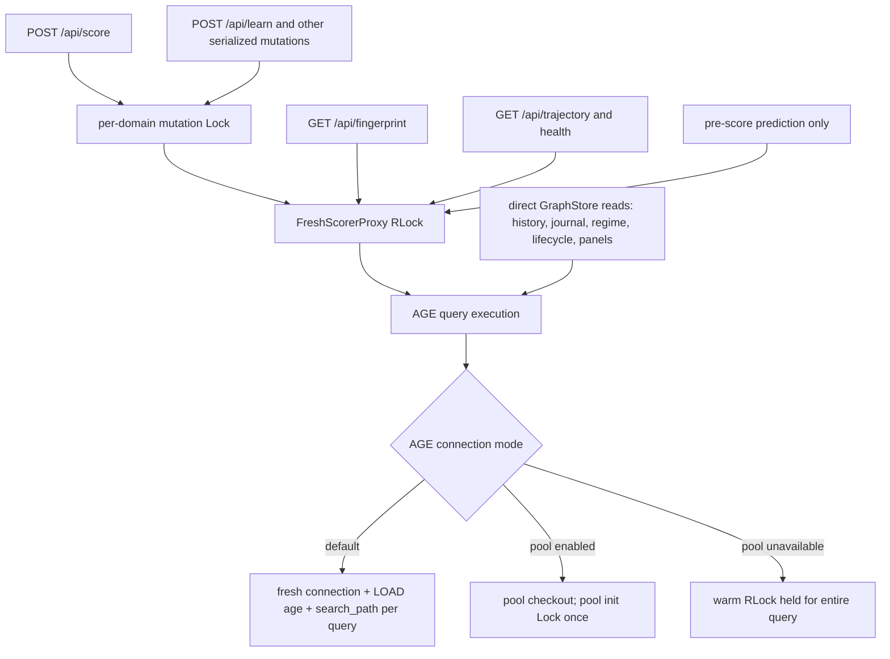

# Trading Backend Latency: Design Drift Analysis

**Diagnostic:** DIAG-DESIGN-DRIFT-TRADING  
**Date:** 2026-10-13  
**Contract:** Trading UI-facing endpoints must complete within 10 seconds.  
**Evidence base:** the completed 333-test Trading Playwright run recorded in `docs/session_state.md` (16 persistent failures, 2 pass-on-retry failures), current source inspection, and Git history. This is a static hot-path analysis; timings and the 8.5 MB history response come from that completed run.

## 1. Executive Summary

Trading's remaining E2E failures are one architectural problem expressed through several endpoints. The original local-store, small-data design assumed that a complete decision read was cheap. The live design now uses Apache AGE, but the read APIs still expose unbounded snapshots, the default AGE client opens and configures a fresh PostgreSQL connection for every query, and request handlers frequently repeat the same snapshot read. A 2026-10-09 AGE-unification change also converted `ResponseMaterializer` from a five-second, shared-snapshot cache into a no-cache compatibility facade: every display read now starts with `get_all_decisions()` and `get_verified_decisions()`, and some computations then query the graph again. Mutation correctness was added independently through a per-domain mutation lock and a scorer-proxy lock. A score itself performs only two point/write queries, but it holds both locks across those database round trips and convoys behind connection and graph pressure generated by read-heavy screens. Five hot paths are P1 drift points and two are P2. The failures are therefore timeout-rooted, but increasing timeouts would only hide the regression.

Two paths named in the task no longer exist. `copilot_sdk/scoring/compounding.py` was not found in the current tree or relevant history; `CompoundingScorer` lives in `copilot_sdk/scoring/scorer.py`. `copilot_sdk/scoring/storage.py` was removed by commit `2891fff` when GraphStore became the source of truth. The repository's `AGENTS.md` explicitly prohibits reviving DecisionStore. Historical DecisionStore behavior and `docs/storage_architecture.md` were used only as evidence of the earlier local/indexed and bounded-retention assumptions.

## 2. Hot Path Profiles

### 2.1 `POST /api/score`

**Full path**

`copilot_sdk/backend/scoring_router.py::score` moves synchronous work to the Starlette thread pool, then `score_sync` acquires `mutation_lock_scope("trading")`. The cached scorer is `GateEnforcedScorer(TradingRegimeScorerProxy(FreshScorerProxy))`. Attribute delegation reaches `TradingRegimeScorerProxy.score`, which computes in-memory regime metadata, briefly enters `FreshScorerProxy._scorer()` to obtain the singleton scorer, then calls `FreshScorerProxy.score`. That method acquires its `threading.RLock` and calls `CompoundingScorer.score`. The scorer predicts in memory, generates an ID, and calls the AGE adapter's `write_governed_decision`. `AGEGraphStore.write_governed_decision` executes:

1. A point read for an existing `(domain, decision_id)`.
2. A `CREATE` for the Decision when it does not exist.

The response is normalized and enriched, cache invalidation runs, and the locks are released.

**Locks.** One domain mutation `threading.Lock` is held for the complete handler. Inside it, one scorer-proxy `threading.RLock` is held across prediction and both AGE calls. `_scorer()` re-enters the same `RLock`; that is safe and is not a third independent lock. The AGE client takes a pool-initialization lock only when pool mode is enabled. In warm-fallback mode it holds `_warm_lock` for a whole query, serializing all graph work on that client. In the current default fresh mode it has no client-wide query lock but pays connection/session setup per query.

**Reads/writes.** The steady-state score path has one point read and one write. It does not scan verified decisions. The important background pressure comes from concurrent page reads, materializer consumers, fingerprint/regime/pre-score requests, and other graph panels using the same AGE database. A newly constructed scorer can also incur warm-start reads, but the app caches one scorer instance, so that is a cold-start condition rather than a per-score cost.

**Contention.** Concurrent scores serialize at the mutation lock. Once admitted, score, learn, fingerprint, trajectory, health, and pre-score's `score_read_only` serialize at the proxy `RLock` where they use the proxy. Direct GraphStore reads do not acquire either application lock, but they compete for database connections, execution, and result materialization. There is no demonstrated lock cycle in this path; the failure mode is a convoy.

**Serialization.** The score response is small. JSON normalization is not the bottleneck.

**Maximum hold time.** There is no application deadline on either graph call. A fresh AGE connection permits a 15-second connect timeout and configures a 120-second PostgreSQL statement timeout. Thus the code-level upper bound is greater than the 10-second contract and can approach two sequential 120-second statements plus connection setup, retries, and queueing. This is an upper bound from configuration, not an observed duration.

### 2.2 `POST /api/trading/pre-score`

**Full path.** `routers/pre_score_router.py::pre_score` validates factors, constructs `PreScorer`, and calls `PreScorer.pre_score`. That call performs:

1. `scorer.score_read_only` under the proxy `RLock`; prediction is in memory and persists no Decision.
2. `_regime_context()` -> `CurrentRegimeContext.current_regime()` -> `_current_market()`, which reads current VIX and one month of SPY OHLCV.
3. `_regime_context()` -> one complete `get_verified_decisions()` scan.
4. `_category_accuracy()` -> a second complete verified scan.
5. `_regime_accuracy()` -> a third complete verified scan.
6. `_find_similar()` -> one complete `get_all_decisions()` scan, then `_correctness_by_decision()` -> a fourth complete verified scan.
7. Python cosine similarity over all same-category decisions, sort, and slice to five.

**Why four verified scans.** Each helper owns its own call to `_verified_decisions()` and the service has no request-local snapshot. The same immutable data is independently fetched for overall regime accuracy, category accuracy, category-with-regime accuracy, and correctness lookup. All four can use one verified list. The full-decision and verified snapshots can also be merged once by decision ID.

**Locks.** Only the read-only prediction is under the proxy `RLock`; graph and market reads occur after that lock is released. No mutation lock is taken.

**Writes.** None. The endpoint's read-only claim is correct.

**Serialization.** The returned top-five set is small. Cost is in five graph snapshots, market I/O, Python vector normalization, and sorting.

### 2.3 `GET /api/fingerprint`

**Full path.** `scoring_router.py::fingerprint` calls `FreshScorerProxy.fingerprint`, holding the proxy `RLock` for the complete operation. `CompoundingScorer.fingerprint()` calls `_verified_decisions()`, which invokes unbounded `get_verified_decisions("trading")`, then computes factor statistics in Python. Its default is `persist=True`. `_persist_fingerprint` hashes the result and, unless the scorer instance has already persisted the same in-memory signature, calls `write_fingerprint`. AGE then performs an existing-fingerprint lookup and may create the fingerprint and link it to the domain summary.

**Locks.** One proxy `RLock` is held across the full graph scan, calculation, and graph writes. No mutation lock protects these writes, so this GET can write concurrently with mutation-locked endpoints while blocking every other proxy operation.

**Queries.** At least one unbounded verified scan. On first/new content, persistence adds a point lookup, create, and domain-link work. The `_last_persisted_fingerprint_signature` optimization is process-local and is checked only after the expensive scan and computation.

**Write on GET.** Yes. Both `/api/fingerprint` and Trading's equivalent scorer call use the default persisting behavior. This violates the fast, idempotent display-read assumption.

**Serialization.** The response is compact. The dominant costs are the scan and write-on-read sequence.

### 2.4 `GET /api/history`

**Full path.** `scoring_router.py::history` resolves the scorer's GraphStore and calls `get_decisions(domain, limit=10**12)`. The AGE implementation clamps that value to 1,000, executes a domain/status-filtered ordered query, converts each graph node and JSON-valued property to Python objects, then `_json_safe` normalizes the entire result for the response.

**Locks.** No mutation or scorer-proxy lock is held during the graph query.

**Queries.** One nominally bounded query, but the HTTP API has no client pagination, cursor, field projection, or payload budget. The caller explicitly asks for an effectively unlimited history and the store silently caps it at a still-large 1,000 full nodes.

**Writes.** None.

**Serialization.** This is the demonstrated response-size failure: the completed run observed about 8.5 MB. Full metadata, probabilities, factor vectors, and nested JSON are decoded and then encoded again. The query count is one, but payload construction and transfer keep the request active long enough to fail Dashboard's all-or-nothing request bundle.

### 2.5 `POST /api/trading/journal/query`

**Full path.** The inline handler in `apps/trading/backend/app/main.py::query_journal` first calls `_journal_records`. That function reads overlay/manual-entry JSON files, copies the in-memory imported trade list, calls unbounded `get_all_decisions("trading")`, normalizes every record, applies overlays, de-duplicates, and sorts the whole combined set by date. Only after this work does `JournalQueryService.query` parse the question, filter all normalized rows in Python, sort the result again, and return every match.

**Locks.** No graph or mutation lock is held. File reads are not protected by `_JOURNAL_LOCK`; write operations use separate file/process locks.

**Queries.** One unbounded graph scan. It is not redundant within one request, but it is needlessly broad because parsing and exact filters happen after retrieval.

**Writes.** None.

**Where filtering belongs.** `JournalQueryService.parse` should run before storage access. Exact category, ticker, action, regime, date, outcome, and factor predicates should be passed to a bounded GraphStore projection that emits only journal fields and applies `WHERE`, ordering, and `LIMIT` in AGE. Manual entries and overlays can then be merged into that bounded result. Questions requiring aggregates should use an aggregate query or a materialized snapshot rather than download every node. The existing `get_all_decisions` protocol cannot express this and must be extended rather than hidden behind more Python filtering.

### 2.6 `GET /api/trading/regime/performance`

**Full path.** `regime_router.py::regime_performance` performs two market-provider reads (VIX and SPY OHLCV), then `_conservation_status`, then creates `RegimePerformanceMapper`. `_conservation_status` issues three aggregate queries through `_state_counts`: `count_verified`, `count_correct`, and `count_verified_decisions` (the first and third delegate to the same canonical count in AGE, so the verified count is queried twice). The mapper then calls `_buckets()` independently from:

1. `per_regime_accuracy()`.
2. `regime_edge()`.
3. `regime_recommendation()` -> `regime_edge()`.

Each `_buckets()` performs a complete unbounded verified-decision query and rebuilds the same Python buckets. Total graph work is six queries: three aggregate queries and three full verified snapshots. The result is compact.

**Locks/writes.** No application lock and no write. The endpoint passed on retry because its latency depends on graph and provider pressure.

**Shareable work.** Build one verified snapshot and one bucket map per request. Compute conservation counts from that snapshot, or fetch the counts once in one aggregate query if exact store-wide semantics differ.

### 2.7 `GET /api/self/rule-lifecycle/{rule_id}`

The actual mounted equivalent of the requested `/api/ae/lifecycle` endpoint is `/api/self/rule-lifecycle/{rule_id}`. The failing UI requested `active`.

**Full path.** `self_computation_router.py::rule_lifecycle` obtains the shared GraphStore, calls `get_evolution_state(domain, rule_id)`, then `get_promotion(domain, rule_id)`. Each delegates to `_get_platform_state`, issuing a separate label/key-filtered query with `ORDER BY updated_at DESC LIMIT 1`, then decodes the stored JSON payload.

**Locks/writes.** No application lock and no write.

**Queries/serialization.** Two bounded point queries and a small response. This path is sound in isolation. Under default fresh AGE mode, however, it opens and configures two separate PostgreSQL sessions and competes with the large scans above. Its pass-on-retry result is environmental load amplification caused by the shared data-access design, not an unbounded lifecycle algorithm.

## 3. Design Drift Table

| Endpoint | Original Assumption | Current Reality | Drift Point | Severity |
|---|---|---|---|---|
| `POST /api/score` | A prediction plus one cheap local durable write; serialization protects rare mutations. | Two AGE round trips occur while both domain and scorer locks are held, with fresh connection setup and no sub-10-second DB deadline; concurrent scores convoy behind graph pressure. | `scoring_router.py::score_sync`; `scorer_proxy.py::score`; `age_graph_store.py::write_governed_decision`; default fresh mode in `age_client.py`. | P1 |
| `POST /api/trading/pre-score` | A read-only preview over a small local history. | One full decision scan plus four identical unbounded verified scans, two market reads, and Python similarity/sorts. | `pre_scorer.py::pre_score` and independently querying helper methods. Present since the feature's introduction (`cca2b37`). | P1 |
| `GET /api/fingerprint` | A display read over a small verified set; persistence is an internal convenience. | Unbounded scan and graph persistence occur under the scorer lock on a GET. | `scorer.py::fingerprint(persist=True)` and `FreshScorerProxy.fingerprint`. Persistence was added in July (`3ab1bf8`/`0efcfdd`). | P1 |
| `GET /api/history` | History was small enough to return as one local-store response. | The handler requests `10**12`; AGE caps to 1,000 full nodes, but the observed payload is still about 8.5 MB and has no HTTP pagination/projection. | `scoring_router.py::history`; limit changed to the effectively-unbounded request in `8c5ef92`. | P1 |
| `POST /api/trading/journal/query` | Imported/demo trade history fit in memory and Python filtering was cheap. | Every query loads, normalizes, overlays, de-duplicates, and sorts the complete graph before parsing/filtering. | `main.py::query_journal`; `routers/journal.py::_journal_records`; `JournalQueryService.query`. | P1 |
| `GET /api/trading/regime/performance` | A small verified history made recomputing each view harmless. | Three duplicate aggregate counts plus three complete verified scans rebuild the same buckets. | `regime_router.py::regime_performance`; `regime_classifier.py::RegimePerformanceMapper._buckets`. Present since `437a2c7`. | P2 |
| `GET /api/self/rule-lifecycle/{rule_id}` | Two bounded point reads are cheap. | The reads remain bounded but each pays a fresh AGE connection/session setup and queues behind broad scans. | Shared AGE connection policy and lack of a combined lifecycle projection; endpoint logic itself has not become unbounded. | P2 |

The strongest commit-level discontinuity is `fca9497` on 2026-10-09. Before it, `ResponseMaterializer` fetched one all-decision and one verified snapshot, computed all registered display responses, published them atomically, and served them for five seconds. The current implementation explicitly “never retains graph-derived responses”: every `get(key)` performs those two scans again and computes only that key. This negates the existing refresh loop and invalidation mechanism and multiplies graph reads during page mounts. The same AGE-unification commit removed the SQLite GraphStore implementation and made AGE the production path, converting formerly local reads into network/database round trips.

## 4. Lock Contention Map

### Lock inventory

| Lock | Scope | Hold interval | Endpoints in this diagnosis |
|---|---|---|---|
| `_MUTATION_LOCKS["trading"]` plain `Lock` | Process/domain | Entire mutating handler, including GraphStore I/O, response shaping, and invalidation | `/api/score`; not used by the diagnosed reads |
| `FreshScorerProxy._lock` `RLock` | One app scorer | Entire delegated scorer method | score, fingerprint, pre-score prediction; indirect health/trajectory traffic |
| `AGEClient._pool_lock` | One AGE client | Pool construction/close only | Any first pooled query |
| `AGEClient._warm_lock` `RLock` | One AGE client | Entire query in warm fallback | Every graph endpoint if pool requested but unavailable |
| `_JOURNAL_LOCK` / file lock | Journal files | Writes only | Not acquired by journal query reads |

### Deadlock and convoy conclusion

No deadlock cycle was found in the seven traced paths. The stable mutation order is domain mutation lock -> scorer `RLock` -> database. Read endpoints either take the scorer lock or call the graph directly. The re-entry in `FreshScorerProxy._scorer()` is valid because the lock is reentrant. Cache invalidation detects an already-held mutation lock where needed, avoiding recursive acquisition of the non-reentrant domain lock.

Convoying is certain by construction: concurrent scores queue at the domain lock; scorer-backed reads queue with scores at the proxy lock; and warm-fallback AGE would serialize all graph queries. In default fresh mode there is no Python graph lock, but many simultaneous scans create a database/connection convoy. The 15-second connection timeout and 120-second statement timeout exceed the UI contract, so neither lock has a useful request-level hold bound.

## 5. Redundant Scan Inventory

### Hot-path query budget

| Scan function | Called by | Times/request | Bounded? | Cacheable/shareable? | Concrete fix |
|---|---|---:|---|---|---|
| `get_verified_decisions` | `/api/trading/pre-score` | 4 | No | Yes, one request snapshot | Fetch once; build category, regime, and correctness indexes from it. |
| `get_all_decisions` | `/api/trading/pre-score` | 1 | No | Yes, merge with verified snapshot | Add category/projected nearest-neighbor read or merge one snapshot in memory. |
| `get_verified_decisions` | `/api/fingerprint` | 1 | No | Yes across display reads and until mutation invalidation | Use `persist=False` on GET and materialize by graph generation. |
| `get_decisions(limit=10**12)` | `/api/history` | 1 | Store caps at 1,000; HTTP is not paged | Response should be page/cursor cached | Add `limit <= 100`, cursor/offset, summary projection, and total count. |
| `get_all_decisions` | `/api/trading/journal/query` | 1 | No | Query-specific | Parse first; push exact filters/order/limit to AGE. |
| `count_verified` | regime conservation | 1 | Aggregate | Duplicates `count_verified_decisions` | One aggregate query or derive from request snapshot. |
| `count_correct` | regime conservation | 1 | Aggregate | Yes | Same combined aggregate/snapshot. |
| `count_verified_decisions` | regime conservation | 1 | Aggregate | Exact duplicate of `count_verified` in AGE | Remove duplicate call. |
| `get_verified_decisions` | regime performance mapper | 3 | No | Yes, identical bucket map | Build `_buckets` once and pass it to all three calculations. |
| `_get_platform_state` | rule lifecycle | 2 | Yes, `LIMIT 1` each | Can combine/cache | One lifecycle projection returning both labels, or short generation cache. |
| `get_all_decisions` + `get_verified_decisions` | every current `ResponseMaterializer.get(key)` | 1 + 1 before each computation | No | Yes; this was the original materializer design | Restore atomic five-second shared snapshot and invalidation. |
| `get_verified_decisions` | materialized fingerprint | +1 after the facade's two base scans | No | Yes | Feed `shared["verified"]` into fingerprint computation. |
| `count_*` + verified scans | materialized conservation/regime detail | Several after the facade's two base scans | Mixed | Yes | Compute from the shared snapshot rather than scorer/store callbacks. |

### Complete direct-call inventory in the Trading backend

The following inventories every direct call matching `count_verified`, `count_correct`, `get_decisions`, `get_verified_decisions`, or `get_all_decisions` under `apps/trading/backend/app` (tests excluded). Calls in the shared SDK that are on a traced Trading path are listed separately.

| File/function area | Calls | Request/startup relationship | Finding |
|---|---|---|---|
| `context_router.py::_analytics_from_store` | all + verified | context analytics/portfolio fallback | Two full scans; materializer should normally supply one shared generation. |
| `main.py` startup restore | all | startup only | One full scan to restore regime monitor; not a per-request cause. |
| `main.py` Trading fingerprint helper | verified | Trading-specific fingerprint read | Full scan; same persistence/read concerns if scorer path used. |
| `routers/claim_gate_router.py` | all + verified + correct | claim-gate status | One full scan plus two aggregates. |
| `routers/analytics.py` | verified | analytics routes | Full verified projection; share/materialize. |
| `routers/evidence.py` | `get_decisions(category, limit=400)` | evidence after scoring | Bounded to at most 400 by AGE; still adds concurrent pressure but is not unbounded. |
| `routers/execution_router.py` | all | execution display | Full scan. |
| `routers/journal.py::_journal_records` | all | journal list, analytics, query | Full scan before Python pagination/filtering. |
| `routers/promotion.py` | verified + correct + verified-total aggregates | promotion status | Three queries, with duplicate verified count. |
| `services/cohort_status.py` | verified/all/decisions fallback | cohort status | Chooses one available full/bounded reader; full on AGE. |
| `services/claim_gate.py` | verified | gate analysis | Full scan. |
| `routers/regime_analytics.py` | all + verified | regime analytics | Two full scans. |
| `services/pre_scorer.py` | all + verified helpers | pre-score | One all + four verified per request. |
| `services/promotion_engine.py` | verified | promotion computation | Full scan. |
| `services/regime_classifier.py` | verified | regime performance | Three calls per performance request. |
| `services/trader_profiles.py` | verified | profile computation | Full scan. |
| `state/compute_helpers.py` | all, fallback decisions | tab-state computation | Full scan on AGE. |
| `services/trust_analysis.py` | `get_decisions(limit=10000)` | trust analysis | AGE caps to 1,000; caller intent remains effectively unbounded. |
| `cli_sdk.py` | counts, decisions, verified | CLI/import only | Not HTTP pressure unless run concurrently; several 10,000-limit reads are capped to 1,000 by AGE. |

Shared SDK calls reached by Trading include `ResponseMaterializer` (all + verified per key), conservation utilities (three counts plus verified, then another verified in `outcomes_from_state` for the full status endpoint), scorer fingerprint/trajectory/phase/alpha/evolution helpers, `GateEnforcedScorer` recent outcomes, self-computation panels, switching-cost, and transfer routes. These shared fixes affect every copilot using the same SDK. `CompoundingScorer` already contains a request-local verified-snapshot mechanism for learning (`_verified_snapshot_active` and `_verified_snapshot_rows`), proving the intended pattern, but display and Trading service paths do not use it.

### Queries without `LIMIT` or selective `WHERE`

The live AGE adapter has the most consequential broad reads:

- `AGEGraphStore.get_verified_decisions(domain)` has a domain/status `WHERE` but no `LIMIT`; it optional-matches outcomes and returns/sorts all active verified decisions.
- `AGEGraphStore.get_all_decisions(domain)` has a domain/archive `WHERE` but no `LIMIT`; it returns/sorts all active decisions.
- `get_decisions` has a `LIMIT`, but `_safe_limit` permits 1,000 and several callers request 10,000 or `10**12`.

The absence of a bounded/filterable verified projection forces handlers to choose between aggregate calls and complete snapshots, which is why the same broad read appears across the backend.

## 6. Recommended Fixes

### P1: restore shared materialization and request snapshots

**Files/functions:** `copilot_sdk/backend/response_materializer.py::ResponseMaterializer`; `apps/trading/backend/app/services/trading_materialization.py::create_trading_materializer`; `copilot_sdk/state` invalidation wiring.

**Change:** Restore the pre-`fca9497` generation model: one refresh obtains one all-decision and one verified snapshot, computes all registered responses from those inputs, and atomically publishes a five-second generation. Preserve the existing nonblocking stale-read behavior and mutation invalidation. Change fingerprint, conservation, trajectory where possible, measurement, and regime computations to consume `shared["verified"]`/`shared["decisions"]` instead of calling the scorer/store again. Do not hold the materializer condition lock while doing graph I/O. Keep a failed refresh from evicting the last good generation.

**Tests unblocked:** dashboard, both demo-narrative Dashboard tests, sweep, fingerprint/analysis under page load, regime flaky, lifecycle flaky indirectly, and score/evidence/log-trade/story-flow indirectly by removing competing graph scans.

**Effort/risk:** M. Shared SDK behavior affects all copilots. Risk is bounded staleness and invalidation races; generation IDs and the prior implementation already address those concerns. Add concurrency tests that prove one refresh per generation and no graph callback on a fresh `get`.

### P1: use pooled AGE connections and enforce a backend latency budget

**Files/functions:** `ci-platform/ci_platform/graph/age_client.py::AGEClient`, Trading graph configuration/launcher environment, and graph health diagnostics.

**Change:** Enable the existing psycopg pool for production/demo Trading with a measured pool size and initialize it during app startup. Fail startup or health-check explicitly if pooling was requested but unavailable; do not silently fall back to one globally locked warm connection for an E2E/demo server. Set PostgreSQL `statement_timeout` and pool acquisition/connect timeouts below the endpoint's remaining 10-second budget (for example, a graph-operation budget passed from the request layer), and surface connection mode plus pool saturation in diagnostics. Keep transaction operations on one checked-out connection.

**Tests unblocked:** broad impact across all 18 failures, especially score, evidence, log-trade, story-flow, lifecycle, and regime.

**Effort/risk:** M. This changes shared infrastructure and affects all copilots. Pool sizing can overload PostgreSQL if chosen blindly; validate with Trading's concurrent E2E request shape and retain a clear 503 on budget exhaustion.

### P1: shorten the score critical section

**Files/functions:** `copilot_sdk/backend/scoring_router.py::score_sync`; `copilot_sdk/backend/scorer_proxy.py::FreshScorerProxy.score`; `ci-platform/ci_platform/graph/age_graph_store.py::write_governed_decision`.

**Change:** Keep the domain mutation lock only around state that truly requires serialization. Prediction is read-only and can run before the mutation lock using an immutable scorer snapshot. Persist the generated decision with one AGE transaction/query using `CREATE` plus uniqueness/idempotency enforcement instead of a point-read followed by a separate create. Hold the proxy lock only while accessing mutable scorer state, not while waiting for durable I/O, after making decision ID generation and prediction state explicit. Preserve the current lock order for any remaining nested section.

**Tests unblocked:** all three log-trade failures, all three evidence failures after ticker data returns, story-flow, and the learn test's score setup.

**Effort/risk:** L. Highest correctness risk: duplicate-ID semantics, scorer mutation assumptions, and score/learn ordering must remain atomic. Add concurrent score tests and an idempotent-write test against AGE before changing lock boundaries.

### P1: bound and page history

**Files/functions:** `copilot_sdk/backend/scoring_router.py::history`; GraphStore protocol and AGE history projection; `apps/trading/frontend/src/screens/DashboardScreen.tsx` history consumer.

**Change:** Replace `limit=10**12` with an explicit endpoint contract: default 50, maximum 100, stable cursor/order, total count, and a summary projection that omits large metadata/factor blobs unless detail is requested. Return newest first for UI use. Update Dashboard to consume the bounded page and render independent request results so one failed optional panel does not erase the portfolio summary.

**Tests unblocked:** dashboard, both demo-narrative tests, and sweep.

**Effort/risk:** M. The response schema changes; retain a temporary compatibility field or version the endpoint. Cursor ordering must be deterministic across equal timestamps.

### P1: give pre-score one snapshot

**Files/functions:** `apps/trading/backend/app/services/pre_scorer.py::PreScorer.pre_score` and helpers; GraphStore filtered decision projection if added.

**Change:** Fetch verified decisions exactly once at the start of the request and build `correctness_by_decision`, category accuracy, regime accuracy, and overall regime accuracy from that list. Fetch candidates with a bounded category filter and only required vector fields; if the protocol cannot yet do that, fetch all once and reuse it. Pass snapshots into pure helper functions rather than letting helpers access the store.

**Tests unblocked:** both pre-score failures.

**Effort/risk:** S for one-request reuse; M for a new filtered GraphStore projection. Low semantic risk if a single snapshot defines request consistency.

### P1: push journal filters and bounds into storage

**Files/functions:** `apps/trading/backend/app/main.py::query_journal`; `services/journal_query.py::JournalQueryService`; `routers/journal.py::_journal_records`; GraphStore protocol and AGE adapter.

**Change:** Split parsing from execution. Parse the question first, translate supported exact fields to a typed query object, and call a new AGE journal projection with domain, predicates, selected fields, deterministic order, and a hard result limit. Merge the small manual-entry source and overlays afterward. For unsupported free-text predicates, apply Python post-filtering only to a bounded candidate set and return a truncation warning. Reuse the same storage query for list endpoints so pagination happens before normalization.

**Tests unblocked:** both journal-query failures.

**Effort/risk:** M. Parser-to-query translation needs exact parity tests; full-result counts may require a separate aggregate query.

### P2: make fingerprint GET read-only

**Files/functions:** `copilot_sdk/backend/scoring_router.py::fingerprint`; `copilot_sdk/backend/scorer_proxy.py::FreshScorerProxy.fingerprint`; `copilot_sdk/scoring/scorer.py::fingerprint`; Trading materializer.

**Change:** Expose `persist` through the proxy and call `fingerprint(persist=False)` for GET endpoints. Persist fingerprints only after learn/mutation or in an explicit background artifact job. Serve the display result from the shared materializer generation. If a fresh synchronous calculation is needed, compute from an injected verified snapshot outside the scorer lock.

**Tests unblocked:** analysis fingerprint directly; reduces contention for score-related failures.

**Effort/risk:** S/M. Consumers that relied on GET to create a graph artifact must move to the explicit mutation hook; audit those consumers before changing the default globally.

### P2: collapse regime and conservation reads

**Files/functions:** `apps/trading/backend/app/routers/regime_router.py::regime_performance`; `services/regime_classifier.py::RegimePerformanceMapper`; `copilot_sdk/backend/conservation_utils.py`; `copilot_sdk/scoring/composite_gate.py::outcomes_from_state`.

**Change:** Give `RegimePerformanceMapper` a verified snapshot or memoized bucket map. Compute all three response sections from that one map. In conservation, do not call `count_verified` and `count_verified_decisions` separately when AGE delegates them to the same query. Pass verified outcomes in the state payload so `build_conservation_status` does not re-read them in `outcomes_from_state`.

**Tests unblocked:** regime flaky directly; lowers graph pressure for all other tests.

**Effort/risk:** S/M. Ensure benchmark/ineligible-decision filtering remains identical across counts and rolling outcomes.

### P2: combine lifecycle point reads

**Files/functions:** `copilot_sdk/backend/self_computation_router.py::rule_lifecycle`; AGE platform-state projection.

**Change:** Add a GraphStore method that returns evolution and promotion state for `(domain, rule_id)` in one query/connection, or serve both from the five-second generation cache keyed by graph invalidation. Keep `LIMIT 1` semantics per label.

**Tests unblocked:** rejection-moment flaky.

**Effort/risk:** S. Low risk; take care that independently updated labels still select their own latest record.

### P2: add bounded query APIs and query-budget telemetry

**Files/functions:** `copilot_sdk/graph/protocol.py`; AGE adapter/store; backend graph-call wrapper and diagnostics.

**Change:** Add explicit bounded/filterable projections rather than letting application code use `get_all_decisions` for UI requests. Record endpoint, graph method, row count, decoded bytes, connection wait, execution time, and serialization time. Enforce per-request query-count and row/byte budgets in tests. Flag calls to `get_all_decisions` and unbounded `get_verified_decisions` from HTTP handlers in static checks.

**Tests unblocked:** preventive rather than a single test; it prevents recurrence across all copilots.

**Effort/risk:** M. Protocol expansion affects all adapters; add methods without changing existing offline/export semantics.

### P3: add AGE indexes and compact projections after measuring plans

**Files/functions:** AGE migration/schema tooling and the query methods above.

**Change:** Capture `EXPLAIN` plans for domain/status/category/timestamp and platform-state label/key reads, add the supported AGE/PostgreSQL indexes for those predicates, and return explicit properties instead of complete nodes on summary routes. Do this after eliminating repeated scans and connection churn so indexes target remaining measured cost.

**Tests unblocked:** none uniquely; adds latency margin for the full suite.

**Effort/risk:** M. Index creation and AGE label-table details are deployment-sensitive; validate write overhead and migration rollback.

## 7. Priority and Expected Test Impact

The first three changes have the largest shared impact: restore the real materializer, enable bounded pooled graph access, and shorten score's locked persistence path. Together they address the read storm, connection churn, and mutation convoy behind the seven score-dependent failures plus the dashboard, fingerprint, regime, and lifecycle failures. Bounded history is the direct fix for four Dashboard-rooted tests. Single-snapshot pre-score and storage-filtered journal queries directly cover the remaining four persistent tests.

Drift-point count from the endpoint table: **5 P1, 2 P2, 0 P3**. P3 appears only in the optimization backlog because no traced endpoint's primary root cause requires an index before the architectural fan-out is fixed.
