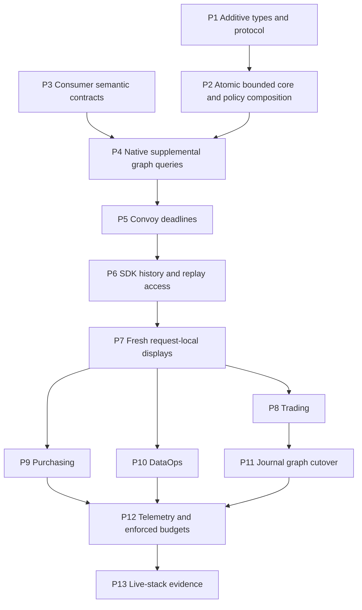

# Bounded projections v3: code-validated correction and delivery plan

Date: 2026-10-15. Scope: design correction, not implementation.

This document supersedes the bounded-projection design's §2.2, §2.3, §7 and §9, and the conflicting materializer, snapshot, journal and budget requirements identified below. The seven dataclasses and four Literal aliases in §2.1 remain unchanged. The stopped IMPL-STORE-TYPES prompt must not be resumed.

**Decision:** preserve `GraphStore` and `ProtocolV2GraphStore`; introduce a separate, optional `BoundedProjectionStore` capability on the same governed graph. Implement policy-aware wrapper variants before exposing the capability through production composition. Cancel the incremental response-cache proposal. Several consumers need additional graph query contracts before their migration can honestly be called bounded and equivalent.

**Readiness:** the generic capability has an execution specification below. The entire 122-site migration is not ready for one mechanical API replacement: P3 is an explicit consumer-contract prerequisite to P4–P12. This is a delivery dependency, not permission to ship incomplete methods, silently truncate history, or claim gaps closed. No implementation or live-stack gap closure is claimed by this document.

## 1. DIAGNOSIS

### 1.1 Evidence and source provenance

Read `docs/session_state.md` and `docs/session_state_overflow.md`. The latter records FIX-DESIGN-BOUNDED-PROJECTIONS as READY, but its seven corrections concern internal consistency. They do not establish runtime/store conformance. The session also records verification-order replay and namespace fixes that must be preserved.

The requested Google Drive documents and all seven requested source files were read from the local Google Drive mirror at `G:/My Drive/public-files/gen-ai-roi/claude_projects/copilot-sdk/`. All nine mirror files were SHA-256 identical to the corresponding working-tree files when inspected. Drive IDs could not be resolved through a Drive API in this environment; this is a mirror-content audit, not an assertion that the IDs were authenticated. Source snapshots and hashes are in `.codex_tmp/bounded_v3/sources/` and `source_manifest.json`.

| Requested source | Supplied Drive ID | Local source read |
|---|---|---|
| Canonical principles | `1g20ZF2zAVOpRgcPcqP39gYf_H4lkUIYx` | `docs/design_principles_v2.md` |
| Original bounded design | `1Rkjp7pEBOXJ4EHc2xE0yCNH5TTyQfuct` | `docs/design_drift_bounded_projections.md` |
| Protocol | `1YiN68TFNIAnwvfVeqUO1z6MB_2JrnQ6S` | `copilot_sdk/graph/protocol.py` |
| Namespace | `12JXWGAnh3jtd3VbWnXLIQw7Nbbxny9-Q` | `copilot_sdk/graph/namespace.py` |
| Factory | `11-LBj75PtuDeuLBx6_ePI-ITyJ-DP_Te` | `copilot_sdk/graph/factory.py` |
| Production boundary | `1HtTSIVXJLDXDea48ph5IZCNi5da6fQzq` | `copilot_sdk/graph/production.py` |
| In-memory implementation | `1l4JBDKOQjMqUsgPZwWvJJoLRdiDKYOG3` | `copilot_sdk/graph/memory_store.py` |
| Legacy visibility | `1CmVNNavzs3pJBlQMUnD9M_hXJgI9kul8` | `copilot_sdk/graph/legacy_signal_filter.py` |
| Tenant visibility | `1Gc30kdfoa5BM8qzyYwIxPr6y4rx_Cn1J` | `copilot_sdk/graph/tenant_store.py` |

All seven source files were read completely before choosing the correction. Additional investigation covered the real AGE adapter/store/client, downstream protocol checks, materializer and tab-state code, journal parser/storage, and the original inventory's functions. Line references below refer to this working tree, which already contains unrelated uncommitted work; they are not assertions about an upstream commit.

A read-only structural probe instantiated the AGE adapter without connecting to a database and checked AGE, memory and namespace objects. All three satisfy today's V2; all three fail a synthetic V2 extended with the three new method names. Adding a separate optional protocol leaves their existing V2 membership intact. The probe passed mypy. Evidence: `.codex_tmp/bounded_v3/protocol_probe.py`. This proves the compatibility mechanism, not future implementation correctness.

The earlier interrupted implementation's test log is diagnostic evidence only. It was contaminated by edits during a running suite; its totals are not a baseline. The subsequent pristine run was stopped. A new, completed baseline is required before implementation.

### 1.2 Existing protocol and ownership relationships

Every protocol in `graph/protocol.py` is runtime-checkable:

| Class and line | Relationship and purpose | Consequence |
|---|---|---|
| `ScoringPersistenceStore:16` | Standalone optional persistence extension | Its docstring explicitly warns that adding required members invalidates AGE and changes governed-write dispatch. Follow this pattern. |
| `ProductionReadyStore:40` | Standalone marker property | Structural membership does not inspect the property's Boolean value; this is not a bounded-query capability check. |
| `GraphStore:56` | Existing base persistence contract | Preserve every signature, including `count_decisions(domain)` at line 223. |
| `GraphTraversalStore:312` | Standalone optional traversal capability | Existing evidence that capabilities need not version the base protocol. |
| `ProtocolV2GraphStore:338` | Extends `GraphStore` and `Protocol` | Governs decisions, observations, conservation, receipts, fingerprints, checkpoints, transfers, traversal summaries, archive/reset and verified counts. Preserve its member set. |
| `L5LearningStore:562` | Standalone optional learning-state capability | Does not require changing V2 to introduce additional operations. |

`ProtocolV2OutcomeStore` in `graph/outcome_service.py:13` combines V2 and L5. It inherits their requirements; it is not an independent escape from V2 changes.

`InMemoryGraphStore` (`memory_store.py:445`) and `AGEGraphStoreAdapter` (`../ci-platform/ci_platform/graph/age_sdk_adapter.py:11`) conform structurally. `GraphStoreNamespace` (`namespace.py:24`) explicitly inherits V2, checks V2 in its constructor (line 35), and overrides/delegates its operations. Its existing count override is at line 342. Inheriting a protocol's ellipsis body is not a usable implementation.

The namespace delegates decision/outcome writes and reads, verified reads/counts, all/archived reads, scalar counts, centroids/checkpoints, evolution, posterior/promotion/ledger/governance state, entity enrichment, graph links/traversals, observations/receipts, conservation/fingerprint/transfer operations, archive and reset. It rewrites domain inputs and strips owned prefixes from structured outputs; `close()` does not close the borrowed primary. New result dataclasses require explicit rewriting, not a new lifecycle owner.

`GraphStoreWrapper` (`production.py:19`) only exposes the reviewed authoritative primary through `graph_primary`; it does not implement read delegation. Production identity validation (`production.py:83,120`) unwraps only this ownership marker and validates the real AGE client/graph identity. Preserve that boundary.

### 1.3 Conflict register

“Immediate” below means the first type gate or execution of the named startup path after installation. Merely importing a new protocol is not necessarily an import-time failure.

| ID | Evidence: file and line | Conflict, effect and timing | Correction / owner |
|---|---|---|---|
| D01 | `protocol.py:16,338`; AGE adapter `:11,339,385` | Extending V2 with three new names makes the existing AGE adapter fail structural membership. Extending only count is invisible to runtime signature checks but incompatible with typed callers. Immediate startup/dispatch regression. | Separate optional protocol; P1. |
| D02 | `namespace.py:24,35,342`; prior failure log `.codex_tmp_bounded_baseline.log:539` | Namespace's count override cannot accept `filters`; mypy fails. Inherited new protocol declarations are not real delegation; a new call could return an ellipsis-body result instead of a page. | Preserve old namespace; explicit bounded namespace subclass, P2. |
| D03 | `factory.py:22,29`; `scoring/scorer.py:393,550`; `evolution/graph_store.py:33`; `backend/graph_signals.py:35`; Purchasing `services/purchasing_control.py:173` | Lost V2 membership affects production checks, governed-write selection, experiment namespaces, evolution construction and Purchasing startup—not just optional new queries. Some paths reject; others select a legacy path. | No change to existing V2 predicates; regression tests at P1/P2. |
| D04 | `backend/health_builder.py:75`; `backend/diagnostics_models.py:118`; `demo/bundle.py:204,365`; legacy wrapper `:150,157,211`; sibling `s2p-copilot/backend/app/routers/s2p.py:1017,1961,2110` | Other V2 checks misclassify capability or skip governed/cross-memory work. Deferred degradation, sometimes no exception. | Include sibling/import/behavioral checks; do not weaken checks. |
| D05 | `legacy_signal_filter.py:233`; `tenant_store.py:240`; original design `:242–246` | `__getattr__` forwards unknown reads directly. Adding methods only to a primary can expose unfiltered pages, aggregates and tombstones through wrappers. A passing `isinstance` does not prove tenant policy. | Explicit bounded variants and deny unknown forwarding of the three new read names in legacy variants; P2 atomic with primary exposure. |
| D06 | `production.py:19,83,120`; original design `:246` | Turning the primary-ownership marker into a generic read implementation advertises capabilities for every subclass, bypasses policy, and confuses ownership with behavior. | Keep marker unchanged. No catch-all forwarding implementation. |
| D07 | `namespace.py:47,64,79,97`; original design `:244` | Returning results unchanged leaks physical `namespace::domain`. Existing recursion covers mappings/lists, not tuple-backed frozen result dataclasses. Post-filtering a page also corrupts page size/cursors. | Explicit dataclass reconstruction and domain/routing rewrite; validate unexpected domains rather than dropping rows. |
| D08 | `tenant_store.py:30,35,48,240`; `scorer.py:393` | Tenant identity currently lives in metadata; missing identity belongs to `default`. `write_governed_decision` is forwarded without `_stamp`. A top-level-only predicate misses existing records and governed writes. | Canonical write/backfill precedence, governed-write tenant override in bounded variant, default-tenant parity tests; P2. |
| D09 | `legacy_signal_filter.py:21–28,86,226,233` | Legacy signal means BOTH metadata keys are present, even if false/empty. A generic truthiness/top-level flag is not equivalent. Verified/count-correct methods currently forward; uniformly filtering them changes visible V if verified legacy rows exist. | Preserve existing aliases' observed policy during core release; make new API policy explicit. Audit verified legacy data before migrating conservation inputs; P2/P3/P6. |
| D10 | `memory_store.py:594,638,700,2062,2128,2171,2551`; AGE store `:827,1022,1365,3866,3937,3994` | Writes have multiple paths. Governed replay and same-outcome verification are idempotent; archive/reset are separate. A create-only counter is incomplete; counting retries as mutations is wrong. AGE archive currently uses multiple independent queries. | Record only committed state changes, atomically with generation, including archive/delete routing; P2. |
| D11 | `memory_store.py:445` initialization and `:2551`; original design `:230–234` | Global `_sequence` is ordering state, not a per-domain feed. Resetting a live domain's generation permits cursor reuse and lost changes. Domain reset deletes the Domain anchor in AGE. | Separate per-physical-domain generation anchors, retained through domain reset; test-only whole-store reset starts a new store lifetime. |
| D12 | Original design `:152,179,234,279–299`; `DecisionPageRequest` offset bound `:129` | `last_mutation_generation <= G` is not historical snapshot isolation. Updating/removing a row already counted shifts later offsets, so untouched rows are skipped. Offset ceiling also prevents rebuilding >10,000 rows. | Remove reset/rebuild cache algorithm. `as_of_generation` becomes an explicit current-generation consistency fence, not history reconstruction; §2.2 below. |
| D13 | Original design `:224–234`; mutable decision dictionaries in `memory_store.py:594,700` | A feed pointing at today's decision loses event-time payloads. Filtering only new values cannot report exit from category/status/tenant scope. Invisible events can trap a client on one watermark. | Immutable event snapshots, routing-only feed filters, scan watermark semantics, immutable routing identity; P2. |
| D14 | Original design Cypher `:167`; AGE store `:1428,2952,4375` | Real relationship is `HAS_OUTCOME`, not `RESULTED_IN`. WHERE attached only after OPTIONAL MATCH can fail to restrict the required Decision match. Archive predicates, normalized outcome fields and join multiplicity are missing. | Separate Decision WHERE and outcome WHERE; explicit projections, active-only semantics, parity tests; P2. |
| D15 | AGE client `:631,697`; original design `:164` | Current “parameters” are string replacement before SQL execution, not driver-bound Cypher values. The draft cannot claim safe binding merely by calling this API. | Implement and integration-test a real parameter-binding path inside AGE client for new queries; preserve old paths until separately migrated. P2. |
| D16 | AGE store `:1237,4338,4375`; memory `_read_decision`; original projection table `:157` | Existing metadata/vectors may be encoded strings; action names and outcome correctness have established normalized names. Draft field labels (“scores”, “learning metadata”) are not executable field sets. | Explicit normalized projection manifest below; do not pass full metadata through narrow projections. P2/P3. |
| D17 | `graph/outcome_service.py:56`; `memory_store.py:1475,1675`; legacy `:217`; original inventory `:460–464` | `_commit` already checks scalar verified counts before/after. `save_centroids` needs a decision count, not a checkpoint ID lookup. In-memory traversal predicates include entity/supplier semantics absent from DecisionFilter. | Correct inventory; do not rewrite unrelated working code to an invented API; P2/P6. |
| D18 | `graph/projection.py:313,326`; constructor near `:244` | AGEProjection is a direct client-backed read surface, not a GraphStore decorator; a method rename cannot supply a composed store or tenant context. | Migrate constructor/callers together or leave compatibility surface intact. P3/P4; no unwrapping to bypass policy. |
| D19 | Principles §8; original design `:263–307,414–419`; `response_materializer.py:80,128,149,224,239` | Cross-request decision map, published responses, TTL and stale-on-failure are a query-serving cache even if AGE remains authoritative. Existing implementation already has this debt; it is not authorization to expand it. | Cancel IMPL-MAT. Fresh graph reads with request-local reuse only; P7. Remove zero-query-after-warmup requirement. |
| D20 | `state/tab_state_cache.py:25,91,173`; Trading `state/trading_registry.py:55,82`; app mains' refresh loops | Replacing only ResponseMaterializer leaves a second graph-backed tab cache, background refresh and stale result storage. It also leaves functions expecting `.get()`/shared full rows. | P7 covers consumers, tab-state graph keys and startup loops together. Static non-platform configuration may remain cached. |
| D21 | `scoring/trajectory.py:28–76`; `iks_service.py:25,45`; `measurement_state.py:141,168`; `scorer.py:3304,3433` | All-history trajectory has one point per ten decisions; measurement uses actual-action arms. The three aggregate metrics and recommended-action grouping cannot reconstruct every result. Replacing all history by latest 400 changes math/output. | P3 enumerates sufficient statistics/windows and bounded output contracts; P4 implements graph reductions. Scorer formulas remain frozen. No silent truncation. |
| D22 | `backend/transfer_router.py:213`; Purchasing `routers/iks.py:61`; DataOps `services/source_trust.py:40` | Financial sums, supplier predicates, source dimensions and richer domain statistics are not supported by the four generic dimensions/three metrics. A bounded prefix gives wrong global results. | Keep generic API small. Additional typed domain query contracts in P3/P4, required before migration of these sites. |
| D23 | Trading `services/journal_query.py:36,91,155`; `routers/journal.py:217,260,350,396` | Journal dates are entry dates, not decision creation/verification dates. Best/worst orders by P&L. Journal uses factors/options, tags, text and global P&L aggregates. Existing HTTP accepts zero limit/unbounded offset. Generic cursor/order/filter types cannot express all of this. | Separate journal contract outside the seven types; exact compatibility/validation and stable entry/P&L cursors, P3/P4/P11. Do not map entry date to created_at. |
| D24 | Trading `routers/journal.py:111,217,490–570`; `_trade_store_ref` import `:18` | Manual journal entries/reflections/tags and imported trades are merged from JSON/process memory. Paging only graph decisions then overlaying these cannot provide correct global order/count. It also violates graph-only platform data policy. | Govern journal facts/annotations in the same graph; import old data with provenance before cutover. Manual facts are not synthetic verified Decisions. P3/P4/P11. |
| D25 | `get_archived_decisions`: memory `:2095`, AGE `:3440`; original design §2.1 | DecisionFilter has no archive selector. Active `full` pages cannot replace backups that include archived records. A total-row cap without an incomplete result is data loss. | Preserve archived APIs until a separate bounded archive/export contract is implemented, P3/P4/P6. Complete traversal or explicit failure; never success on a truncated backup. |
| D26 | `scoring/mutation_lock.py:29`; `backend/scoring_router.py:168`; AGE client `:385,631,725` | Lock acquisition is blocking; stale predictions can be recomputed under lock. Pool retries, transaction statements, serialization and worker-thread cancellation all consume deadline. An HTTP timeout alone can leave a write running. | Absolute deadline propagated to lock/pool/transaction/retries, terminal commit/rollback evidence and idempotent retry semantics; P5. |
| D27 | AGE store `:1022–1170`; client `:631,697,725`; original budget `:418` | One governed transaction is not one physical graph/SQL query. Counting only outer GraphStore calls misses internal queries and retries. “Decoded bytes” is not wire bytes. | Separate logical operations, statements, rows/decoded payload bytes and waits; instrument execution boundaries once, P12. |
| D28 | Original inventory `:456–555` | Eighteen path substitutions are needed to locate the intended functions; six namespace sites are unnamed; scorer has two `_verified_decisions` definitions. “122” was a planning count, not 122 uniquely validated locations. | Corrected, source-resolved ledger below. Preserve the 122 planning entries; disclose the extra scorer definition and namespace-count coverage. |
| D29 | Original sequence `:633–641`; stopped IMPL-STORE-TYPES scope | Original IMPL-STORE actually included AGE and wrappers. The narrowed types+memory prompt split out required fixes while mutating V2. P2-3 ownership also straddles STORE/HISTORY; MAT/CONVOY both edit scoring_router, TRADING/JOURNAL both edit main. | Additive P1; atomic exposure P2; explicit serialized shared-file owners and dependencies, §9. |
| D30 | `pyproject.toml` mypy `follow_imports="skip"` and backend `ignore_errors`; `tests/test_type_checking.py`; prior log `:539–585` | Checking only three files can miss namespace/subscriber breakage; configured ignored modules do not prove clean changed-file typing. A running baseline can import edited files in subprocesses. | Complete baseline first; unsuppressed changed-file/type-consumer gates and cross-repo imports per prompt. No blanket ignore, casts or weakened tests. |
| D31 | Original design `:199–214`; `DecisionGroup`/`DecisionAggregate` in §2.1 | Grouping has no page/limit parameter; arbitrary dimension values can produce an unbounded result. A row limit also does not bound arbitrarily large metadata/text bytes. | Enforce an explicit group ceiling with an error, and separate row/decoded-byte budgets. Do not silently truncate groups or evidence. P2/P3/P12. |

### 1.4 Canonical principles and rejected alternatives

| Principle | Required consequence of this correction |
|---|---|
| 1. One governed graph | New protocols and stateless views target the existing authoritative store. No SQLite, side database, per-arm store, or read replica pretending to be the primary. |
| 2. Cross-memory capability | Preserve traversals and V2 dispatch; entity/supplier traversal cannot be replaced by a domain-only prefix query. |
| 3. Decisions vs observations | Counts of V require verified human outcomes. Journal imports and market observations do not create verified Decisions. |
| 4. Conservation | Keep `alpha * q * V >= theta_min`, current scope semantics and rolling verified-window mathematics. Validate order and eligibility, not merely equal row count. |
| 5. Distinct judgment memory | Preserve judgment memory as a distinct cognitive type, including factor quality and structure; do not reduce it to confidence averages or collapse it into observations. |
| 6. Geometry and scope | Do not truncate replay or erase eligible scope to meet a read budget. |
| 7. Centroids | Keep reference geometry; do not introduce a new classifier through the read redesign. |
| 8. No alternate query substrate | Reject persistent or cross-request decision/response/tab caches, stale fallback and reading the outage outbox. Permit only request-local memoization that preserves graph semantics. Graph indexes and governed graph facts stay in the same substrate. |
| 9. Real shared-graph experiments | InMemory proves contracts only. Reasoning/closure probes use the real shared AGE path with scoped namespaces, not isolated per-arm memory. |
| 10. Governed transfer | Preserve transfer artifacts, source/target scope and provenance. Never use generic query capability to escape domain/tenant governance. |

Rejected: extending V2 before all implementations; weakening production checks; fake default implementations; generic forwarding on GraphStoreWrapper; switching production to InMemory; a “non-authoritative” response cache; a full decision-map bootstrap; replacing global analytics with a bounded sample; treating JSON journal overlays as an allowed outbox. Each either breaks compatibility or violates the principles above.

## 2. CORRECTED DESIGN

### 2.1 Replacement for original §2.2: capability placement and contract

The new protocol is **optional and additive**. Its methods are operations on the existing GraphStore, not an independent persistence service. `GraphStore`, `ProtocolV2GraphStore`, `GraphTraversalStore`, `L5LearningStore`, `ScoringPersistenceStore`, `ProductionReadyStore`, and `ProtocolV2OutcomeStore` remain unchanged.

Place the seven §2.1 dataclasses and their four Literal aliases unchanged in `copilot_sdk/graph/query.py`, with the design's validation rules. Re-export all public query types from `protocol.py` and `graph/__init__.py`; query.py imports neither of those modules. In particular, do not substitute the stopped prompt's frozensets, alternate field names, list responses, total_estimate, global mutation counter, or create/verify mutation enum for the authoritative types.

Add to `protocol.py`:

```python
@runtime_checkable
class BoundedProjectionStore(GraphStore, Protocol):
    """Optional bounded queries over this store's existing governed graph."""

    def query_decisions(
        self, domain: str, *,
        filters: DecisionFilter | None = None,
        projection: DecisionProjection = "summary",
        page: DecisionPageRequest | None = None,
        as_of_generation: int | None = None,
    ) -> DecisionPageResult: ...

    def count_decisions(
        self, domain: str, *, filters: DecisionFilter | None = None,
    ) -> int: ...

    def aggregate_decisions(
        self, domain: str, *,
        filters: DecisionFilter | None = None,
        group_by: tuple[DecisionGroup, ...] = (),
        metrics: tuple[DecisionMetric, ...] = ("count",),
    ) -> tuple[DecisionAggregate, ...]: ...

    def get_decision_changes(
        self, domain: str, *, after_generation: int,
        limit: int = 1_000,
        projection: DecisionProjection = "full",
        filters: DecisionFilter | None = None,
    ) -> DecisionChangePage: ...
```

The optional protocol overrides count; the base protocols do not. Extending InMemory's concrete count signature and overriding it on the bounded AGE adapter is backward compatible. A legacy third-party GraphStore need not implement the capability. A migrated consumer accepts/requires `BoundedProjectionStore` explicitly; its non-migrated V2 behavior stays intact. Do not scatter `hasattr` or unchecked `cast` as capability validation.

#### Query/filter/order semantics

- The generic API reads **active Decisions only**. Observations and archives are not folded into these counts.
- Empty tuple collection filters impose no restriction; multiple nonempty predicates combine with AND; collection values use IN. Do not interpret empty tuples as match-none or use the abandoned frozenset schema.
- Verified means confirmed/overridden. `correct=True` and `correct=False` both require verified status and compare actual correctness; pending is not an incorrect outcome. Contradictory predicates naturally return no rows. Confidence bounds are inclusive; timestamp bounds are lower-inclusive, upper-exclusive. Missing required predicate values do not match.
- Query/count/aggregate use the same predicate compiler. `actions`/group `action` use `recommended_action`, **not** `actual_action`; callers needing actual-action arms require the supplemental contract.
- Validate runtime Literal values, finite numeric cursor/bound values, ID bounds, limit/offset and incompatible cursor/offset/order combinations. Do not silently clamp invalid new-API input. `after_generation` is a nonnegative integer; change limit is 1–1,000.
- Sort by `(requested_timestamp, decision_id)` with both components in the requested direction. Do not mix `_sequence` into the new cursor order. Preserve legacy `_ordered_decisions` and `_decision_page` contracts unchanged.
- `verified_at` ordering excludes unverified records; use the persisted Outcome verification timestamp, with the existing verified-record fallback to created_at for historical missing outcomes. Filtering a verification date on an unverified row never matches. Canonicalization tests must cover `verified_at` vs `verified_at_epoch` rather than treating them as interchangeable.
- Read `limit + 1`, project at most `limit`, and set a cursor on the last returned row only when more rows exist. No automatic count. Ordinary keyset pages are live reads: late verification can enter/move in a verified order. They are not claimed to be a database snapshot.
- **Corrected `as_of_generation`:** a nonnegative current-generation fence. Within the same read transaction/lock as the page, require the domain generation to equal the supplied value; otherwise raise `DecisionGenerationChanged` (a defined conflict exception). It does not resurrect old versions or filter out later-mutated rows. Retain the prohibition on combining it with a cursor. A successful page is consistent at that generation; a multi-page offset reader must discard/restart its work on conflict, within a bounded retry budget. Large offline consistent traversal uses the supplemental transaction/cursor export contract. No online cache rebuild uses this parameter.

This explicitly changes the original `as_of_generation` semantics to remove an unsound historical-snapshot claim without changing any dataclass. Example regression: read A,B from A,B,C,D, mutate/archive A, then request offset 2 at the old generation. The result must be a conflict, never D with C silently missing.

#### Projection normalization

Projection manifests are explicit allowlists, shared by contract tests; fields absent in historical data normalize to documented null/default values, not arbitrary full metadata.

| Projection | Field contract |
|---|---|
| summary | `decision_id`, `domain`, `category`, `recommended_action`, `status`, `confidence`, `created_at`, `verified_at`, `is_correct`, `correct`. The two correctness names agree for verified rows and are null for pending. |
| scoring | summary plus `category_index`, `recommended_index`, `factor_vector`, `factor_names`, `factors`, `probabilities`, `actual_action`, `actual_index`, `source`, `scorer_version`, `preset_version`, `factor_schema_version`, `outcome`, `verified_at_epoch`, `quality_signal`, `was_override`, `analyst_action`, `final_action`, and `learning_metadata`. |
| journal | summary plus `trade_id`, `entry_id`, `ticker`, `regime`, `entry_time`, `exit_time`, `entry_price`, `exit_price`, `size`, `pnl`, `strategy_tag`, `tags`, `source`, `reflection`, `notes`, `factors`, `options_factors`. This is a projection of a Decision; it is not the unified manual/imported journal query contract. |
| full | Existing complete normalized Decision plus normalized Outcome fields, including outcome_metadata; hide implementation-only sequence/generation bookkeeping. |

`learning_metadata` is an allowlisted object: `reward`, `verifier`, `override_reason`, `variant_id`, `regime_tag`. Adding a consumer-required field needs an explicit manifest change and equivalence test in P3, not silently returning all metadata. Unknown factors/options and arbitrarily large text do not make online budgets disappear; P3 records the consumer's byte bounds and full-detail lookup needs. Response-size limits may reject an oversized row explicitly; they must not silently mutilate persisted evidence.

P3 must verify these manifests against consumer inputs before changing consumers; the data types themselves remain fixed. Store contract tests reject accidental metadata leakage in summary/scoring/journal and prove returned mutable containers cannot mutate stored decisions or stored feed events.

#### Count and aggregate

Count is scalar and storage-side in AGE. Group dimensions and metrics remain precisely the four/three §2.1 aliases. Invalid/duplicate dimensions or metrics raise ValueError. No grouping returns one aggregate, including on an empty set. Requested count/correct_count are zero on an empty set; undefined `avg_confidence` is omitted from `values` (the type cannot represent None). With grouping and no matches, return an empty tuple. Missing dimension values are represented by absence of that key from `dimensions`, distinguishing null from an actual empty string. Stable group ordering is required.

The generic aggregate returns at most 1,000 groups. AGE fetches at most 1,001 grouped result rows; a larger result raises a defined `ProjectionCardinalityExceeded` error rather than returning a partial aggregate. A caller requiring more groups uses a separately paged supplemental contract. This is a result-size bound, not a promise that AGE examines only 1,000 source nodes; query deadlines and native query plans govern database work.

Do not globally rewire legacy aliases in P2 when their historical visibility/order differs. A bounded consumer uses explicit `verified=True`/`correct=True`; aliases may migrate once parity is established for their existing wrapper policy. OutcomeService's before/after verified count logic stays intact.

#### Feed and mutation transactions

- Per **physical domain**, persist a monotonic committed generation and event in the same AGE transaction as the decision mutation. Serialize allocation through commit so readers cannot advance past an uncommitted lower generation. InMemory uses equivalent domain counters and a lock; `_sequence` remains independent.
- Create and successful verification produce `upsert`; an existing supported decision update produces `upsert`; archive/delete produce `delete` for the active-decision view. Idempotent governed replay and identical-outcome replay produce no extra event. Rejected writes produce none. Do not add a new outcome-overwrite API merely to exercise “update.”
- Upsert records own event-time normalized payloads. Returned payloads are independent copies. Tombstones retain the pre-removal tenant, legacy flag and domain. Routing identity is immutable for a decision; a transfer of identity requires a separately governed delete/create operation, not a silent metadata mutation.
- `get_decision_changes(filters=...)` accepts **routing predicates only**: tenant and exclude_legacy_signals. Reject other non-default DecisionFilter fields. A category/status/confidence filter cannot safely represent view exits using the current event type, and no cache requires that behavior after this correction.
- Capture a committed upper watermark H for the read. Select visible events with `after < generation <= H`, ascending, with limit+1. If more visible events remain, next_generation is the last returned event; otherwise next_generation is H, even when the visible page is empty. Thus invisible events do not prevent progress. current_generation is H. An after value above H is an invalid/stale-store cursor, not a successful empty continuation.
- Retain events initially. Domain reset emits tombstones and preserves its generation anchor/feed. Whole-store test reset invalidates all cursors by starting a new store lifetime. Future retention must define recovery before setting reset_required; the nonexistent cache rebuild is not a recovery implementation. P2 leaves reset_required false and performs no compaction.
- Backfill active records idempotently with routing properties and one initial event per decision; record migration completion in the same graph. Validate duplicate IDs/ambiguous timestamps/tenant conflicts explicitly. Writes, backfill and activation use one coordinated rollout so older writers cannot invalidate canonical fields or omit events after capability activation.

#### AGE implementation boundary

The SDK adapter owns SDK dataclasses. The lower-level AGE store may use primitive typed arguments/results and must not introduce a ci-platform-to-SDK runtime import cycle. Test imports in both installation orders. New queries run through AGEClient's tested binding path; never interpolate caller-supplied property identifiers, sort directions, or values with ad-hoc replacement.

Keep `AGEGraphStoreAdapter` as the old-capability adapter and add `BoundedAGEGraphStoreAdapter` in the same module. The latter implements the three new reads and extended count, and requires the same-graph canonicalization/feed migration marker before construction succeeds. Factory selects it only after that readiness check; otherwise it selects the legacy adapter for legacy consumers. Thus a class with unusable new methods is never advertised as a ready bounded store. This is a capability rollout, not query-time fallback. A deployment enabling a bounded consumer must require the marker and reject an unsupported primary at startup.

Operational order for P2: install the compatible writer/migration code as one coordinated package set; quiesce older writers during canonicalization and feed initialization; run and reconcile the idempotent backfill; commit its readiness marker; enable bounded composition; restart/probe callers. Do not promise zero-downtime mixed-writer rollout: an older writer can omit both canonical fields and feed events. Every intermediate code release remains compatible with legacy consumers; enabling new consumers is a later gated action.

Canonical routing preserves observed policies: tenant is the non-null top-level tenant when present, otherwise metadata tenant, with a missing/empty value treated as `default`; authenticated new writes stamp both representations consistently. Legacy status is derived from presence of both `signal_detail` and `signal_timestamp` in metadata, independent of their values. Backfill reports conflicting representations before activation.

For the generic contract, source uses the normalized top-level value then metadata source; ticker uses top-level then metadata and uppercase normalization on both writes and filter input. Regime uses the journal normalizer's precedence (top-level regime, metadata regime, top-level market_regime, metadata market_regime); regime_tag remains distinct learning metadata unless a reviewed migration proves equivalence. Created/verified times follow the timestamp/outcome rules above. Journal field normalization follows `_normalize_trade` without loading external overlays, including metadata.entry_time/date, size/shares, and pnl/pnl_dollars fallback. These rules are sufficient for P2 and do not depend on P3. Consumers using a different population or regime basis remain on their existing path until P3/P4 supplies an equivalent supplemental query. Missing data is not invented.

Logical query shape (binding syntax is owned/tested in AGEClient): match Decision; WHERE physical domain + active predicate + Decision filters; optional `HAS_OUTCOME`; apply outcome/date/cursor predicates through WITH/WHERE; select only projection properties; order; skip; limit+1. Verify generated SQL/Cypher against the installed AGE server. Do not claim a schematic query is executable AGE syntax. Indexes/canonical fields are native to the same graph. An aggregate must return aggregate rows, not all source decisions for Python aggregation.

### 2.2 Replacement for original §2.3: truthful optional capability through wrappers

Do not add bounded members to `GraphStoreWrapper` or to legacy protocol classes. Use explicit bounded policy variants, preserving legacy constructors:

- `BoundedLegacySignalFilteringGraphStore(LegacySignalFilteringGraphStore)` requires a BoundedProjectionStore primary and implements all four methods. Each delegates once with a replaced filter setting exclude_legacy_signals=True.
- `BoundedTenantScopedGraphStore(TenantScopedGraphStore)` requires a BoundedProjectionStore primary. It injects authenticated tenant scope, rejects conflicts, implements all four operations, and stamps governed writes. Capture tenant once per operation. Read/count/feed use identical effective tenant semantics, including the historical default tenant.
- `BoundedGraphStoreNamespace(GraphStoreNamespace)` requires both V2 and bounded capability at construction. It delegates using the physical domain and reconstructs frozen result containers to strip namespace domain values from rows and event routing. Cursors/generations stay unchanged; embedded user payload strings are not blindly rewritten. It remains a borrowed view, not a production marker.

Use explicit selector functions in factory/namespace composition to choose the bounded variant only when the wrapped object actually has the capability. Retain old variants for old GraphStore/V2 implementations. Legacy tenant/legacy wrappers must raise AttributeError for the three new unknown read names in `__getattr__`; they must not accidentally advertise/forward policy-bypassing reads. Their existing count signature remains unchanged. This is a deliberate boundary on unknown reads, not a fake implementation or a catch-and-fallback mechanism.

Factory returns GraphStore as before. A typed `require_bounded_projection_store` helper narrows for migrated consumers and fails configuration early if an enabled feature lacks support. ProductionReady/identity validation remains separate and unchanged. A failed readiness check must not silently switch to memory, raw AGE, or an unbounded legacy implementation.

P2 ships implementations, variants, selector wiring, canonical write/backfill and tests as one exposure unit. Supported combinations are old core with old consumers, and activated new core with new consumers. Test an unsupported legacy primary: old consumers still work, bounded membership is false, and no new endpoint is enabled. Audit active AGE handles in all three SDK apps, S2P, and SOC; transparent handles may delegate only to the fully composed primary and do not justify skipping policy adapters.

### 2.3 Consequential corrections to original §3–§6 and §8

**§3 is replaced.** There is no cross-request decision map, incremental response materializer, generation TTL, warmup snapshot or stale-on-failure result. A request acquires a graph read context, executes native bounded projections/reductions, optionally shares identical reads within that request, constructs the response and discards the context. No outbox reads. Graph failure returns the established unavailable response; it does not select stale or fabricated state. Remove graph-derived TabStateCache serving and its background refresh dependencies in the same consumer release. Static configuration not derived from platform data is outside this prohibition.

The four generic methods do not magically provide all-history fingerprints, trajectories, actual-action arm coverage, financial totals, or arbitrary journal predicates. P3 must define supplemental optional **GraphStore query capabilities** for those exact consumers, then P4 implements them in the same AGE substrate with policy-aware views and InMemory contracts. These are graph queries, not another query-serving store. They may return bounded sufficient statistics or exact paginated derived points; frozen scorer formulas remain authoritative. Neither a persistent derived-response cache nor a full decision list hidden behind a new method is acceptable.

If a response claims its multiple counts/windows describe one snapshot, the supplemental operation must execute them in one consistent read transaction on the same primary. A request-local dictionary alone provides no isolation, and independent query/count calls do not become a snapshot because they share a request ID. Transaction-backed contexts are request-scoped and closed before returning; they never expose a secondary store.

**§5 is replaced for unsupported journal operations.** Parse before graph I/O. Push predicates through a typed journal graph contract that distinguishes entry dates from Decision dates and supplies entry/P&L ordering, stable continuation, exact count/aggregate semantics, factors, tags/text and merged record identity. Legacy inclusive end-date behavior must be preserved or explicitly versioned; don't silently convert a calendar date to an exclusive midnight cutoff. Empty-limit and offset behavior need explicit HTTP compatibility tests. Exact totals cannot be computed from a 2,000-row prefix. When a bounded scan is deliberately partial, expose an explicit partial result in a versioned API; never label it an exact total/best result. Manual journal facts and annotations migrate into the governed graph before JSON/process-memory reads are removed. They remain distinct from verified Decisions.

**§4 budgets remain targets, not measured claims.** P5 enforces one absolute deadline across preparation, lock wait, pool wait, stale-preparation retry, transaction, invalidation and serialization. Cancellation must reach database work and preserve terminal transaction/lock ownership. Do not release a lock while a timed-out worker can still commit. Concurrency tests must exercise retries and cancellation, not only sleeping mock functions.

**§6 budgets are corrected.** Zero graph queries after cache warmup is removed. A simple page plus exact count has at most two logical read operations; actual AGE statements are measured separately. A grouped scalar dashboard can use one native aggregate. Display budgets depend on the exact bounded read contracts from P3. A score uses one governed mutation transaction, which can contain multiple statements. Budget both statement count and decoded rows/bytes, and account for binding/control statements, retries and pool/lock time. P12 establishes observed limits with tests; no universal “1 query” assertion on a multi-statement write.

**§8 tests are corrected.** Replace cache-refresh/TTL tests with request-local reuse, no cross-request data reuse, fresh-graph dependence and graph-outage tests. Add negative capability tests, complete wrapper composition, namespace result rewriting, default tenant and legacy marker parity, >10,000-row cursor traversal, tied timestamps, both sort directions, late verification, archive/reset feed atomicity, idempotency, rollback, generation conflicts, invisible-event watermark advancement, and real AGE field/binding parity. Never update golden scorer values merely to accommodate different filtering or truncated inputs.

### 2.4 Replacement for original §7: corrected ownership and inventory

The 122 entries remain a **migration ledger**, not a claim that the four generic methods cover every entry. Eighteen path corrections are reflected in Appendix A. All corrected named functions were resolved by AST; the six previously unnamed namespace entries are now explicit. `scorer.py` has both method and module `_verified_decisions`; both are in scope. `namespace.count_verified_decisions:186`, omitted from the original six, is additionally tested. Thus 122 is the preserved planning count, not the total blast radius or a gap-closure count.

| Original group | Planning entries | Corrected ownership / disposition |
|---|---:|---|
| Store/wrappers | 23 | P2 capability/policies; P4 AGEProjection supplemental bridge; P6 read-diff/offline callers. OutcomeService and in-memory traversals remain unchanged unless a separately proven defect requires work. |
| SDK backend | 15 | P6 eligible counts/history; P7 request-local display; P3/P4 prerequisites for richer reductions. |
| Scoring core | 19 | P6 access/replay changes only after P3 establishes exact windows/order/sufficient statistics; mathematics frozen. |
| Trading | 21 | P8 app consumers; P11 journal; P7 owns shared display and initial main wiring first. |
| Purchasing | 19 | P9 after graph reductions and request-local display. |
| DataOps | 11 | P10 after graph reductions and request-local display. |
| Other SDK | 8 | P6; retain complete offline semantics and graph-governed transfer. |
| Migration/tools | 6 | P6; corrected `migrate/` paths, explicit archive/export contract, complete-or-fail traversal. |

| Gap | Corrected owner | Prerequisite and closure evidence |
|---|---|---|
| P1-1 | P7 (replaces IMPL-MAT) | P3/P4 native read contracts; no cross-request cache; fresh graph query/row budgets. |
| P1-2 | P5 | Absolute deadline plus real pool/transaction cancellation probe. |
| P1-3 | P6 | P2 capability and P4 when generic queries cannot preserve semantics. |
| P1-4 / P2-1 | P8 | Exact pre-score windows and app reductions; no new scorer math. |
| P1-5 | P11 | P3/P4 journal contract and graph migration; ordering/count/predicate parity. |
| P1-6 / P2-4 | P9 | Supplier/order/statistical contract, category and verified parity. |
| P2-2 | P10 | Source/schema/context query contract and bounded output. |
| P2-3 | P2 infrastructure, P6 consumers | Ownership separated by file and release; no consumer enabled before safe composition. |
| P2-6 | P12 | Physical execution telemetry and endpoint budgets, then live evidence. |
| P2-7 | P7 | Graph failures unavailable; no stale cache and no unbounded alternate read path. |

Existing gaps not assigned in the source design are not silently declared closed. Additional discoveries D19–D24 are prerequisites to the claimed migration, not optional follow-up optimizations. Appendix A records every original entry with a real path/line and owner.

### 2.5 Replacement for original §9: release sequence

The former nine prompts become thirteen explicit batches. P3 is a design/acceptance-contract batch; P13 is live verification. Each source-changing batch is an independently green release, not a partial commit waiting for the next prompt to fix its tests.



P1 and P3 can run in parallel with no production-file overlap or dependency; P3 may overlap P2 as well. P8/P9/P10 can run in parallel after P7, using disjoint app/test manifests. P11 follows P8 because both own Trading main/context/CLI surfaces. P4/P5/P12 share AGE implementation files and are serialized. P5/P6/P7 share scoring_router and are serialized. Every session-log append/integration commit is serialized by the integrator; parallel workers do not edit the common log.

The dependency critical chain is P1 → P2 → P4 → P5 → P6 → P7 → P8 → P11 → P12 → P13, with P3 also required before P4. P9 or P10 becomes the elapsed-time critical branch if it takes longer than P8+P11. No unsupported time estimates or predetermined test-count deltas are used.

## 3. EXECUTION PLAN

### 3.1 Gate that applies to every prompt

1. Read this correction, canonical principles, applicable AGENTS, session state, and the complete changed-file/dependent-caller set. Preserve unrelated working-tree edits. Recheck source hashes/line references if the tree has changed.
2. Finish baseline tests **before** editing. Record actual passed/failed/skipped/xfailed counts and exact environment. A failing baseline is an explicit prerequisite to resolve/triage; it is not permission to label the release green or mask failures.
3. Add behaviorally meaningful contracts. Existing tests remain enabled. Run changed-file mypy with the repository configuration and the unsuppressed changed-file gate (including graph wrappers and typed consumers); run existing type-checking tests. Do not count `ignore_errors` or skipped imports as verification of those changed files.
4. Run SDK tests and affected app/ci-platform suites in their proper import environments (the apps use the same `app` package name). Run sibling import/startup smoke tests where composition is affected. No source edits while a baseline/gate process is running.
5. Check import order, supported legacy composition, new capability composition, frozen scorer outputs, migrations and rollback/activation preconditions. A multi-repo P2/P4 change is released as one tested dependency set. Do not deploy new consumers to an old or unbackfilled primary.
6. Ship only with zero introduced failures, clean required mypy, and passing import checks. Record measured counts, not `BASELINE + expected-tests` invented in advance. This document prescribes these gates; it does not claim they have already run for future code.
7. Append implementation evidence to session state. Code/test success means implemented and verified at that layer. Rule #85 requires P13 live evidence before a gap can be closed.

### 3.2 Prompt briefs and acceptance criteria

| Prompt | Work to execute | Tests / proof required before the next dependent prompt |
|---|---|---|
| **P1 IMPL-BOUNDED-CONTRACT** | Add unchanged §2.1 types, validators, exports, optional protocol. No concrete methods, factory activation, or legacy protocol signature changes. | Dataclass/signature/validation contracts; old V2 runtime membership and namespace construction unchanged; old count calls unchanged; import-cycle and mypy tests. Post-release: old code remains functional; new capability is not falsely present. |
| **P2 IMPL-BOUNDED-CORE** | Implement memory and AGE queries/feed/transactions/canonical writes/backfill; binding path; bounded policy variants/selectors and negative forwarding guards. Coordinate adapter+SDK release and activation. | Shared memory/AGE contract suite; composed tenant→legacy→AGE and bounded namespace tests; rollback/idempotency/generation/archive/reset tests; native query projection and scalar-count checks; data/backfill parity; production identity tests; old adapter compatibility. Post-release: new capability is complete where activated; old stores remain usable by old consumers. |
| **P3 DESIGN-CONSUMER-CONTRACTS** | Produce the exact supplemental contracts and per-entry semantic/byte/cardinality manifest described below. Reconcile original test/HTTP shapes and all-history math. No source changes. | Every generic-API mismatch D18–D25 gets an explicit contract and acceptance fixture, not a guessed 400-row substitute. Documentation gate resolves input/output types, windows, archives, journal migration and production binding. Post-release: executable source is unchanged; no consumer is switched yet. |
| **P4 IMPL-NATIVE-READ-MODELS** | Implement approved supplemental optional graph capabilities on the same primary, memory contracts, AGE native reductions/paging, policy variants, and AGEProjection compatibility bridge. No endpoint cutover yet. | Exact sufficient-statistic parity against frozen computations; all-history/actual-action/financial/entry-date/P&L cases; native row bounds; graph identity and tenant/namespace tests; archive export completeness. Post-release: new APIs are complete, old consumers still work. |
| **P5 IMPL-CONVOY-DEADLINES** | Add deadline-aware lock admission/waiter bounds and propagate remaining time through prepare/persist, retries, pool/transaction and terminal cancellation handling. | Deterministic lock/overload/stale-preparation/cancellation tests; real AGE rollback/no-late-write probe; full score/learn regression. Post-release: old call signatures remain valid with default deadlines, new HTTP budget contract works. |
| **P6 IMPL-SDK-BOUNDED-READS** | Migrate eligible SDK history/count/replay/DI/reporting/read-diff/offline access. Select bounded namespace for capable stores; keep legacy paths for unsupported old stores only in non-migrated features. Preserve formulas and replay verification order. | Old/new outputs on identical records incl tied creation/verification dates, late verification, pending and legacy rows, actual-action arms, >10k histories, archived backup/restore and complete-or-fail export. Post-release: migrated features require complete capability; no unbounded silent fallback. |
| **P7 IMPL-REQUEST-GRAPH-DISPLAY** | Replace graph-serving response/tab caches with fresh request-local reads; migrate shared routers, app registrations, background startup loops and Trading graph-key registry together. Preserve compatible HTTP shapes; version bounded trajectory output if required by P3. | No cross-request graph-data reuse; one request can share reads safely; multi-tenant isolation; fresh write immediately reflected; outage yields unavailable; no outbox read; app startup and tab/direct endpoint parity. Post-release: no migrated display depends on a removed cache. |
| **P8 IMPL-TRADING-READS** | Migrate Trading non-journal consumers using the approved precise windows/reductions. No scorer arithmetic changes. | Pre-score/regime/promotion/analytics/profile/CLI/startup equivalence and bounded graph traffic; full Trading tests. Post-release: app works before journal cutover. |
| **P9 IMPL-PURCHASING-READS** | Migrate supplier/order/control/evidence/trust/PAR/CLI paths. | Auto-order/control/conservation gates and supplier-specific statistics; exact weekly PAR availability behavior; archive backup; full Purchasing suite. Post-release: independent of Trading/DataOps app changes. |
| **P10 IMPL-DATAOPS-READS** | Migrate source/schema/timeline/RSI/context paths and startup counts. | Source-trust and RSI/timeline equivalence, limits and graph-outage semantics; full DataOps suite. Post-release: independent of Trading/Purchasing app changes. |
| **P11 IMPL-JOURNAL-GRAPH-CUTOVER** | Migrate manual/imported journal facts and annotations with provenance into the shared graph; remove JSON/process-list serving; parse first, execute exact bounded journal predicates/order/count/aggregate. | Entry vs creation date, inclusive date ends, null dates, P&L ties, residual predicates beyond first 2k rows, manual/decision ID collisions, tags/reflection writes, imported rows, graph outage, rollback and HTTP compatibility. Post-release: one graph-backed journal source; no fake verified V. |
| **P12 IMPL-QUERY-BUDGETS** | Instrument physical AGE execution and SDK request context; propagate context through threadpool work; wire three app middleware layers; enforce measured endpoint budgets. | No double count, retry/transaction statement coverage, concurrent context isolation, decoded-byte definition, reset of request state, no backend type-check suppression, endpoint budget tests. Post-release: all migrated endpoints have truthful measured budgets. |
| **P13 VERIFY-LIVE-BOUNDED-PROJECTIONS** | Run shared-AGE probes through real production composition for all migrated surfaces, including S2P/SOC compatibility and scoped reasoning experiments. Record commands, graph identity, commit/package set, timings/rows and results. | Live tenant/legacy/namespace isolation, first/warm request traffic, unavailable behavior, live score cancellation and frozen reasoning baselines. Only passing live evidence can close the named gaps. |

### 3.3 Required P3 contract output (no implicit design debt)

Write `docs/design_bounded_consumer_contracts.md`, with a row for every Appendix A site and these four specifications:

1. **Read-model sufficient statistics:** exact fields, scope, actual vs recommended action, all-history vs recent-window population, tie order, byte/cardinality bounds and formula equivalence for fingerprint, trajectory, measurement, conservation, transfer-dollar, supplier/source/RSI/domain analytics. For trajectory, preserve existing prefix-point values with a paged derived-point contract; never call the latest-400 result the all-history trajectory. Fix a deterministic HTTP compatibility/versioning path before endpoint implementation. No formula changes in compounding/learning/conservation/trajectory/fingerprint.
2. **Journal capability:** typed request/response/cursor outside the seven generic dataclasses; entry-time and P&L order; exact filtered totals and monetary metrics; normalized factors/tags/text; unified governed record identity, tenant scope, and provenance. Define journal facts/annotations as non-Decision facts and their write/read methods through GraphStore capabilities. Explain migration of manual JSON, reflections, imported trade references and every writer. No side store.
3. **Archive/export capability:** bounded active+archived traversal within a consistent read transaction or equivalent explicit generation validation; record ordering, maximum batch, completeness manifest and resumable offline failure semantics. Full export means full evidence, not a capped active subset.
4. **Projection/caller manifest:** confirm or explicitly amend narrow projection allowlists, identify already-scalar/no-change entries, exact tests/HTTP models/frontends requiring versioning, and exact production/test files for P4–P12. Append newly discovered files to the blast-radius manifest in this document before execution; an unresolved contract prevents its implementation prompt from starting.

This prerequisite is necessary because the user explicitly preserves the seven dataclasses and scorer math. Claiming those types already express these operations would repeat the original design error. P3 can finish while P1/P2 execute because it neither edits their source nor changes the four generic method contracts.

## 4. BLAST RADIUS

### 4.1 Interpretation and immutable boundaries

Paths below are relative to `copilot-sdk/` unless prefixed `../ci-platform/`. New paths are marked `(new)`. Each prompt may change only its manifest plus its own tests and a serialized session-state append. A manifest change discovered in P3 is a design amendment, not silent scope expansion by a later implementation prompt. Future changed test files must be enumerated in that amendment; do not use “all related tests” as a write allowance.

Across all prompts: no DecisionStore/SQLite, no alternate graph/cache/outbox reader, no changes to existing base/V2 protocol member sets, no weakening of production graph identity validation, no frozen scorer-math edits. `production.py` remains unchanged. Existing graph/SDK/app files not listed for a prompt remain unchanged by that prompt. Existing source debt outside the corrected ledger is not automatically in scope. Sibling S2P/SOC production code is audited/tested for compatibility and stays unchanged unless P3 identifies a concrete caller migration with an explicit manifest amendment.

The manifests distinguish infrastructure from consumer work; “unchanged” means unchanged by that prompt, not an assertion that the user's working tree is clean.

### 4.2 Exact initial manifests

**P1 — change only:**

- `copilot_sdk/graph/query.py` (new)
- `copilot_sdk/graph/protocol.py` (new optional class and re-exports only)
- `copilot_sdk/graph/__init__.py`
- `tests/test_bounded_projection_types.py` (new)
- `tests/test_bounded_capability_compatibility.py` (new)

P1 leaves memory_store, namespace, tenant/legacy wrappers, factory, AGE and all apps/scorer files unchanged.

**P2 — change only:**

- `copilot_sdk/graph/memory_store.py`
- `copilot_sdk/graph/legacy_signal_filter.py`
- `copilot_sdk/graph/tenant_store.py`
- `copilot_sdk/graph/namespace.py`
- `copilot_sdk/graph/factory.py`
- `copilot_sdk/graph/capabilities.py` (new, typed optional-capability requirements/selectors)
- `copilot_sdk/graph/query.py` (conflict exception/shared normalization constants; dataclass shapes unchanged)
- `copilot_sdk/graph/__init__.py`
- `../ci-platform/ci_platform/graph/age_sdk_adapter.py`
- `../ci-platform/ci_platform/graph/age_graph_store.py`
- `../ci-platform/ci_platform/graph/age_client.py`
- `../ci-platform/ci_platform/graph/bounded_projection.py` (new, lower-level compiler/normalization)
- `../ci-platform/ci_platform/graph/bounded_projection_migration.py` (new, idempotent same-graph backfill/activation)
- `tests/test_bounded_projection_contract.py` (new)
- `tests/test_bounded_projection_wrappers.py` (new)
- `tests/test_bounded_capability_compatibility.py`
- `../ci-platform/tests/test_bounded_projection.py` (new)
- `../ci-platform/tests/test_bounded_projection_age.py` (new)
- `../ci-platform/tests/test_bounded_projection_migration.py` (new)

P2 leaves outcome_service, projection, read_diff_runner, scorer and app source unchanged. Existing tests exercising changed behavior are run; if legitimate updated API expectations require modifying an existing test, enumerate it before editing. Neither suppress nor delete a failing test.

**P3 — change only:** `docs/design_bounded_consumer_contracts.md` (new) and this document's approved manifest/consumer-contract amendments. No production source or test behavior changes. Session-log integration is serialized.

**P4 — initial implementation manifest, finalized by P3 before execution:**

- `copilot_sdk/graph/domain_queries.py` (new, supplemental dataclasses/protocols; no edits to the seven generic types)
- `copilot_sdk/graph/memory_store.py`
- `copilot_sdk/graph/legacy_signal_filter.py`
- `copilot_sdk/graph/tenant_store.py`
- `copilot_sdk/graph/namespace.py`
- `copilot_sdk/graph/capabilities.py`
- `copilot_sdk/graph/factory.py`
- `copilot_sdk/graph/projection.py`
- `copilot_sdk/graph/__init__.py`
- `../ci-platform/ci_platform/graph/age_sdk_adapter.py`
- `../ci-platform/ci_platform/graph/age_graph_store.py`
- `../ci-platform/ci_platform/graph/domain_queries.py` (new, native query implementations)
- `tests/test_domain_query_contract.py` (new)
- `tests/test_domain_query_wrappers.py` (new)
- `../ci-platform/tests/test_domain_queries_age.py` (new)

P4 does not switch app endpoints or existing external AGEProjection constructors without their caller files being added by P3. Keep the old constructor operational until its complete caller migration. Supplemental capability advertisement obeys the same truthful-wrapper rule as P2.

**P5 — change only:**

- `copilot_sdk/scoring/mutation_lock.py`
- `copilot_sdk/backend/scoring_router.py`
- `copilot_sdk/backend/scorer_proxy.py`
- `copilot_sdk/graph/deadline.py` (new)
- `../ci-platform/ci_platform/graph/age_client.py`
- `../ci-platform/ci_platform/graph/age_graph_store.py`
- `../ci-platform/ci_platform/graph/age_sdk_adapter.py`
- `tests/test_mutation_lock.py`
- `tests/backend/test_score_deadlines.py` (new)
- `../ci-platform/tests/test_age_deadlines.py` (new)

P5 leaves graph protocols/query types, app source and scorer arithmetic unchanged.

**P6 — change only (read-access changes; preserve computations):**

- `copilot_sdk/backend/scoring_router.py`
- `copilot_sdk/backend/conservation_utils.py`
- `copilot_sdk/backend/health_builder.py`
- `copilot_sdk/backend/self_computation_router.py`
- `copilot_sdk/backend/switching_cost_router.py`
- `copilot_sdk/backend/transfer_router.py`
- `copilot_sdk/scoring/composite_gate.py`
- `copilot_sdk/scoring/gate_enforced_scorer.py`
- `copilot_sdk/scoring/iks_service.py`
- `copilot_sdk/scoring/measurement_state.py`
- `copilot_sdk/scoring/scorer.py`
- `copilot_sdk/scoring/trust_traps.py`
- `copilot_sdk/demo/bundle.py`
- `copilot_sdk/di/enrichment.py`
- `copilot_sdk/di/nl_query.py`
- `copilot_sdk/di/query_providers.py`
- `copilot_sdk/outcome/router.py`
- `copilot_sdk/reporting/weekly.py`
- `copilot_sdk/transfer/cross_domain.py`
- `copilot_sdk/graph/read_diff_runner.py`
- `copilot_sdk/migrate/shadow_scorer.py`
- `copilot_sdk/migrate/verify_state.py`
- `copilot_sdk/migration/rehearsal.py`
- `tests/test_bounded_sdk_consumers.py` (new)
- `tests/test_bounded_replay_export.py` (new)

P6 leaves graph storage/wrappers and all app source unchanged. The migration verifier's legacy mirror is an offline tool; it need not be falsely declared a production bounded store. No edits to formula-only trajectory/fingerprint/conservation/learning implementations.

**P7 — change only, with P3-enumerated HTTP/model changes added before execution if necessary:**

- `copilot_sdk/backend/request_graph_projection.py` (new)
- `copilot_sdk/backend/response_materializer.py` (remove graph-serving implementation once all callers migrated; no stale compatibility fallback)
- `copilot_sdk/backend/scoring_router.py`
- `copilot_sdk/backend/conservation_router.py`
- `copilot_sdk/state/tab_state_cache.py`
- `copilot_sdk/state/tab_state_router.py`
- `copilot_sdk/state/cached_static.py`
- `copilot_sdk/state/cached_quasi_static.py`
- `copilot_sdk/state/invalidation.py`
- `copilot_sdk/state/__init__.py`
- `apps/trading/backend/app/main.py`
- `apps/trading/backend/app/services/trading_materialization.py`
- `apps/trading/backend/app/state/trading_registry.py`
- `apps/trading/backend/app/state/compute_helpers.py`
- `apps/purchasing/backend/app/main.py`
- `apps/dataops/backend/app/main.py`
- `tests/test_response_materializer.py` (replace graph-cache assertions with the new contract; retain regression coverage)
- `tests/test_request_graph_projection.py` (new)
- `apps/trading/backend/tests/test_materializer_invalidation.py`
- `apps/purchasing/backend/tests/test_materializer_invalidation.py`
- `apps/dataops/backend/tests/test_materializer_invalidation.py`

P7 leaves native query implementations, graph protocols and scorer math unchanged. P3 must enumerate any additional decorator/registry/model/test consumers before this release; removing a cache class while leaving its dependents broken is prohibited.

**P8 — change only:**

- `apps/trading/backend/app/cli_sdk.py`
- `apps/trading/backend/app/context_router.py`
- `apps/trading/backend/app/main.py`
- `apps/trading/backend/app/routers/analytics.py`
- `apps/trading/backend/app/routers/claim_gate_router.py`
- `apps/trading/backend/app/routers/execution_router.py`
- `apps/trading/backend/app/routers/promotion.py`
- `apps/trading/backend/app/routers/regime_analytics.py`
- `apps/trading/backend/app/services/claim_gate.py`
- `apps/trading/backend/app/services/pre_scorer.py`
- `apps/trading/backend/app/services/promotion_engine.py`
- `apps/trading/backend/app/services/regime_classifier.py`
- `apps/trading/backend/app/services/trader_profiles.py`
- `apps/trading/backend/app/state/compute_helpers.py`
- `apps/trading/backend/tests/test_bounded_read_consumers.py` (new)

P8 leaves journal.py/journal_query.py, other apps and shared SDK/AGE implementation unchanged.

**P9 — change only:**

- `apps/purchasing/backend/app/main.py`
- `apps/purchasing/backend/app/routers/auto_order_router.py`
- `apps/purchasing/backend/app/routers/evidence.py`
- `apps/purchasing/backend/app/routers/iks.py`
- `apps/purchasing/backend/app/routers/learning_beats.py`
- `apps/purchasing/backend/app/routers/regime_router.py`
- `apps/purchasing/backend/app/routers/scorecard_router.py`
- `apps/purchasing/backend/app/routers/trust_router.py`
- `apps/purchasing/backend/app/routers/verify_router.py`
- `apps/purchasing/backend/app/services/purchasing_control.py`
- `apps/purchasing/backend/cli.py`
- `apps/purchasing/backend/tests/test_bounded_read_consumers.py` (new)

P9 leaves `app/cli.py` (the wrong original inventory target), predictive_par/par_optimizer arithmetic, other apps and shared SDK/AGE source unchanged.

**P10 — change only:**

- `apps/dataops/backend/app/context_router.py`
- `apps/dataops/backend/app/main.py`
- `apps/dataops/backend/app/routers/di_gateway_router.py`
- `apps/dataops/backend/app/routers/regime_router.py`
- `apps/dataops/backend/app/services/source_trust.py`
- `apps/dataops/backend/tests/test_bounded_read_consumers.py` (new)

P10 leaves Trading/Purchasing and shared SDK/AGE source unchanged.

**P11 — initial manifest; P3 must enumerate every importer/overlay writer before execution:**

- `apps/trading/backend/app/services/journal_query.py`
- `apps/trading/backend/app/services/journal_graph_migration.py` (new)
- `apps/trading/backend/app/routers/journal.py`
- `apps/trading/backend/app/routers/data_import.py`
- `apps/trading/backend/app/context_router.py`
- `apps/trading/backend/app/main.py`
- `apps/trading/backend/app/cli_sdk.py`
- `apps/trading/backend/tests/test_journal.py`
- `apps/trading/backend/tests/test_journal_query.py`
- `apps/trading/backend/tests/test_journal_graph_migration.py` (new)

P11 leaves SDK query types/AGE implementations unchanged because its complete graph contract shipped in P4. It does not delete historical JSON or mutate live graph data merely by installing code; the audited migration/cutover is an explicit operational step with reconciliation and rollback evidence.

**P12 — change only:**

- `copilot_sdk/graph/query_budget.py` (new)
- `copilot_sdk/graph/memory_store.py`
- `../ci-platform/ci_platform/graph/age_client.py`
- `../ci-platform/ci_platform/graph/age_graph_store.py`
- `../ci-platform/ci_platform/graph/age_sdk_adapter.py`
- `apps/trading/backend/app/main.py`
- `apps/purchasing/backend/app/main.py`
- `apps/dataops/backend/app/main.py`
- `tests/test_query_budget.py` (new)
- `../ci-platform/tests/test_age_query_budget.py` (new)
- `apps/trading/backend/tests/test_query_budgets.py` (new)
- `apps/purchasing/backend/tests/test_query_budgets.py` (new)
- `apps/dataops/backend/tests/test_query_budgets.py` (new)

P12 leaves protocol signatures, wrapper visibility, scoring formulas and frontend behavior unchanged.

**P13 — change only:** `scripts/probe_bounded_projections.py` (new) and `docs/validation/bounded_projections_v3_live.md` (new). It may append session evidence, but must not change implementation to make a failing probe green inside the verification prompt. A failure returns to the owning implementation batch and repeats its gates.

### 4.3 Validation performed for this design revision

- Read all required sources; compared nine Drive-mirror/repo file hashes.
- Resolved the corrected 122 named inventory entries by AST, including exact source lines; corrected eighteen paths and disclosed duplicate scorer helper names.
- Ran the read-only optional-protocol reproduction: AGE, memory and namespace preserve existing V2 conformance; the synthetic expanded V2 fails for all three as predicted.
- Ran mypy on that probe: **Success: no issues found in 1 source file**.
- No production Python source was changed for this design task. No full-suite, performance, production migration or live-gap-closure result is claimed. Future gate rows above are required checks, not pre-certified successes.

## Appendix A. Source-resolved 122-entry migration ledger

The following table is generated from the source design's entries with the verified path corrections. P3 records exact semantic fit before each consumer implementation. A line list on one entry means multiple definitions need attention; it does not increase the original planning count.

| # | Correct source and line(s) | Symbol | Owner / disposition |
|---:|---|---|---|
| 1 | `copilot_sdk/graph/legacy_signal_filter.py:226` | `_count` | P2 |
| 2 | `copilot_sdk/graph/legacy_signal_filter.py:74` | `get_all_decisions` | P2 |
| 3 | `copilot_sdk/graph/legacy_signal_filter.py:217` | `save_centroids` | P2 |
| 4 | `copilot_sdk/graph/memory_store.py:2445` | `_contextual_judgment_with_view` | P2 parity; preserve traversal/checkpoint behavior |
| 5 | `copilot_sdk/graph/memory_store.py:2515` | `_query_similar_with_view` | P2 parity; preserve traversal/checkpoint behavior |
| 6 | `copilot_sdk/graph/memory_store.py:1475` | `count_verified` | P2 parity; preserve traversal/checkpoint behavior |
| 7 | `copilot_sdk/graph/memory_store.py:1675` | `save_centroids` | P2 parity; preserve traversal/checkpoint behavior |
| 8 | `copilot_sdk/graph/namespace.py:148` | `get_decisions` | P2 |
| 9 | `copilot_sdk/graph/namespace.py:170` | `get_verified_decisions` | P2 |
| 10 | `copilot_sdk/graph/namespace.py:158` | `get_all_decisions` | P2 |
| 11 | `copilot_sdk/graph/namespace.py:342` | `count_decisions` | P2 |
| 12 | `copilot_sdk/graph/namespace.py:180` | `count_verified` | P2 |
| 13 | `copilot_sdk/graph/namespace.py:336` | `count_correct` | P2 |
| 14 | `copilot_sdk/graph/outcome_service.py:56` | `_commit` | Unchanged; scalar-count regression P2/P6 |
| 15 | `copilot_sdk/graph/projection.py:313` | `get_category_breakdown` | P3/P4 constructor and query contract |
| 16 | `copilot_sdk/graph/projection.py:326` | `get_profile_snapshot` | P3/P4 constructor and query contract |
| 17 | `copilot_sdk/graph/read_diff_runner.py:213` | `_compare_active` | P6 (P3/P4 if supplemental semantics required) |
| 18 | `copilot_sdk/graph/tenant_store.py:132` | `count_correct` | P2 |
| 19 | `copilot_sdk/graph/tenant_store.py:135` | `count_decisions` | P2 |
| 20 | `copilot_sdk/graph/tenant_store.py:126` | `count_verified` | P2 |
| 21 | `copilot_sdk/graph/tenant_store.py:129` | `count_verified_decisions` | P2 |
| 22 | `copilot_sdk/graph/tenant_store.py:78` | `get_all_decisions` | P2 |
| 23 | `copilot_sdk/graph/tenant_store.py:84` | `get_verified_decisions` | P2 |
| 24 | `copilot_sdk/backend/conservation_utils.py:278` | `_baseline_q` | P6 (P3/P4 if supplemental semantics required) |
| 25 | `copilot_sdk/backend/conservation_utils.py:129` | `_state_verified_decisions` | P6 (P3/P4 if supplemental semantics required) |
| 26 | `copilot_sdk/backend/conservation_utils.py:477` | `state_counts` | P6 (P3/P4 if supplemental semantics required) |
| 27 | `copilot_sdk/backend/health_builder.py:66` | `build_graph_health` | P6 (P3/P4 if supplemental semantics required) |
| 28 | `copilot_sdk/backend/response_materializer.py:104` | `refresh` | P7 |
| 29 | `copilot_sdk/backend/scoring_router.py:361` | `history` | P6 (P3/P4 if supplemental semantics required) |
| 30 | `copilot_sdk/backend/self_computation_router.py:697` | `_count_correct` | P6 (P3/P4 if supplemental semantics required) |
| 31 | `copilot_sdk/backend/self_computation_router.py:689` | `_count_verified` | P6 (P3/P4 if supplemental semantics required) |
| 32 | `copilot_sdk/backend/self_computation_router.py:681` | `_get_all_decisions` | P6 (P3/P4 if supplemental semantics required) |
| 33 | `copilot_sdk/backend/self_computation_router.py:685` | `_get_verified_decisions` | P6 (P3/P4 if supplemental semantics required) |
| 34 | `copilot_sdk/backend/self_computation_router.py:67` | `_verified` | P6 (P3/P4 if supplemental semantics required) |
| 35 | `copilot_sdk/backend/self_computation_router.py:504` | `decisions` | P6 (P3/P4 if supplemental semantics required) |
| 36 | `copilot_sdk/backend/switching_cost_router.py:41` | `_decision_count` | P6 (P3/P4 if supplemental semantics required) |
| 37 | `copilot_sdk/backend/switching_cost_router.py:30` | `_decision_records` | P6 (P3/P4 if supplemental semantics required) |
| 38 | `copilot_sdk/backend/transfer_router.py:213` | `_pattern_dollar_impact` | P6 (P3/P4 if supplemental semantics required) |
| 39 | `copilot_sdk/scoring/composite_gate.py:78` | `outcomes_from_state` | P6 (P3/P4 if supplemental semantics required) |
| 40 | `copilot_sdk/scoring/gate_enforced_scorer.py:122` | `_get_recent_outcomes` | P6 (P3/P4 if supplemental semantics required) |
| 41 | `copilot_sdk/scoring/iks_service.py:45` | `_verified_decisions` | P6 (P3/P4 if supplemental semantics required) |
| 42 | `copilot_sdk/scoring/measurement_state.py:141` | `_verified_decisions` | P6 (P3/P4 if supplemental semantics required) |
| 43 | `copilot_sdk/scoring/scorer.py:2704` | `_checkpoint_quality` | P6 (P3/P4 if supplemental semantics required) |
| 44 | `copilot_sdk/scoring/scorer.py:2642` | `_compute_iks` | P6 (P3/P4 if supplemental semantics required) |
| 45 | `copilot_sdk/scoring/scorer.py:3433` | `_conservation_stats` | P6 (P3/P4 if supplemental semantics required) |
| 46 | `copilot_sdk/scoring/scorer.py:3110` | `_maybe_archive` | P6 (P3/P4 if supplemental semantics required) |
| 47 | `copilot_sdk/scoring/scorer.py:3197` | `_run_evolution` | P6 (P3/P4 if supplemental semantics required) |
| 48 | `copilot_sdk/scoring/scorer.py:2974` | `_save_centroids_checkpoint` | P6 (P3/P4 if supplemental semantics required) |
| 49 | `copilot_sdk/scoring/scorer.py:3452, 3304` | `_verified_decisions` | P6 (P3/P4 if supplemental semantics required) |
| 50 | `copilot_sdk/scoring/scorer.py:1981` | `capture_existing_state` | P6 (P3/P4 if supplemental semantics required) |
| 51 | `copilot_sdk/scoring/scorer.py:2616` | `export` | P6 (P3/P4 if supplemental semantics required) |
| 52 | `copilot_sdk/scoring/scorer.py:493` | `from_preset` | P6 (P3/P4 if supplemental semantics required) |
| 53 | `copilot_sdk/scoring/scorer.py:2420` | `get_alpha` | P6 (P3/P4 if supplemental semantics required) |
| 54 | `copilot_sdk/scoring/scorer.py:2411` | `get_phase` | P6 (P3/P4 if supplemental semantics required) |
| 55 | `copilot_sdk/scoring/scorer.py:1121` | `get_verified_count` | P6 (P3/P4 if supplemental semantics required) |
| 56 | `copilot_sdk/scoring/scorer.py:2306` | `trajectory` | P6 (P3/P4 if supplemental semantics required) |
| 57 | `copilot_sdk/scoring/trust_traps.py:143` | `_verified_decisions` | P6 (P3/P4 if supplemental semantics required) |
| 58 | `apps/trading/backend/app/cli_sdk.py:351` | `_counts` | P8 |
| 59 | `apps/trading/backend/app/cli_sdk.py:519` | `export_sdk` | P8 |
| 60 | `apps/trading/backend/app/cli_sdk.py:486` | `journal_sdk` | P8 |
| 61 | `apps/trading/backend/app/context_router.py:513` | `_analytics_from_store` | P8 |
| 62 | `apps/trading/backend/app/main.py:316` | `_auto_seed_if_needed` | P8 |
| 63 | `apps/trading/backend/app/main.py:465` | `_run_startup_locked` | P8 |
| 64 | `apps/trading/backend/app/main.py:729` | `clone_fingerprint` | P7/P8 |
| 65 | `apps/trading/backend/app/routers/analytics.py:131` | `_verified_decisions` | P8 |
| 66 | `apps/trading/backend/app/routers/claim_gate_router.py:21` | `claim_gate` | P8 |
| 67 | `apps/trading/backend/app/routers/execution_router.py:26` | `_trades` | P8 |
| 68 | `apps/trading/backend/app/routers/journal.py:217` | `_journal_records` | P11 |
| 69 | `apps/trading/backend/app/routers/promotion.py:86` | `_conservation_status` | P8 |
| 70 | `apps/trading/backend/app/routers/regime_analytics.py:38` | `_read_decisions` | P8 |
| 71 | `apps/trading/backend/app/services/claim_gate.py:92` | `refresh_from_store` | P8 |
| 72 | `apps/trading/backend/app/services/pre_scorer.py:200` | `_all_decisions` | P8 |
| 73 | `apps/trading/backend/app/services/pre_scorer.py:207` | `_verified_decisions` | P8 |
| 74 | `apps/trading/backend/app/services/promotion_engine.py:196` | `_category_decisions` | P8 |
| 75 | `apps/trading/backend/app/services/regime_classifier.py:147` | `_verified_decisions` | P8 |
| 76 | `apps/trading/backend/app/services/trader_profiles.py:82` | `_verified_decisions` | P8 |
| 77 | `apps/trading/backend/app/state/compute_helpers.py:26` | `compute_all_decisions` | P8 |
| 78 | `apps/trading/backend/app/state/compute_helpers.py:259` | `count_decisions` | P8 |
| 79 | `apps/purchasing/backend/app/main.py:408` | `_auto_seed_if_needed` | P9 |
| 80 | `apps/purchasing/backend/app/main.py:747` | `_graph_order_rows` | P9 |
| 81 | `apps/purchasing/backend/app/main.py:807` | `predictive_par` | P9 |
| 82 | `apps/purchasing/backend/app/main.py:821` | `predictive_par_week` | P9 |
| 83 | `apps/purchasing/backend/app/routers/auto_order_router.py:148` | `_category_verified_decisions` | P9 |
| 84 | `apps/purchasing/backend/app/routers/auto_order_router.py:140` | `_store_for_state` | P9 |
| 85 | `apps/purchasing/backend/app/routers/evidence.py:235` | `_all_decisions` | P9 |
| 86 | `apps/purchasing/backend/app/routers/evidence.py:246` | `_verified_decisions` | P9 |
| 87 | `apps/purchasing/backend/app/routers/iks.py:61` | `_supplier_rows_from_graph` | P9 |
| 88 | `apps/purchasing/backend/app/routers/learning_beats.py:186` | `_verified` | P9 |
| 89 | `apps/purchasing/backend/app/routers/regime_router.py:36` | `_payload` | P9 |
| 90 | `apps/purchasing/backend/app/routers/scorecard_router.py:123` | `_verified_decisions` | P9 |
| 91 | `apps/purchasing/backend/app/routers/trust_router.py:161` | `_decisions_total` | P9 |
| 92 | `apps/purchasing/backend/app/routers/verify_router.py:160` | `_already_verified` | P9 |
| 93 | `apps/purchasing/backend/app/services/purchasing_control.py:198` | `_decisions` | P9 |
| 94 | `apps/purchasing/backend/app/services/purchasing_control.py:206` | `_verified` | P9 |
| 95 | `apps/purchasing/backend/app/services/purchasing_control.py:67` | `refresh` | P9 |
| 96 | `apps/purchasing/backend/cli.py:430` | `backup` | P9 |
| 97 | `apps/purchasing/backend/cli.py:375` | `conservation` | P9 |
| 98 | `apps/dataops/backend/app/context_router.py:119` | `_graph_decisions` | P10 |
| 99 | `apps/dataops/backend/app/context_router.py:1207` | `accuracy_by_category` | P10 |
| 100 | `apps/dataops/backend/app/context_router.py:856` | `pipelines` | P10 |
| 101 | `apps/dataops/backend/app/context_router.py:1341` | `process_timeline` | P10 |
| 102 | `apps/dataops/backend/app/context_router.py:904` | `rsi_summary` | P10 |
| 103 | `apps/dataops/backend/app/context_router.py:1312` | `schema_impact` | P10 |
| 104 | `apps/dataops/backend/app/context_router.py:1254` | `transformations` | P10 |
| 105 | `apps/dataops/backend/app/main.py:551` | `_auto_seed_if_needed` | P10 |
| 106 | `apps/dataops/backend/app/routers/di_gateway_router.py:23` | `verification_history` | P10 |
| 107 | `apps/dataops/backend/app/routers/regime_router.py:36` | `_payload` | P10 |
| 108 | `apps/dataops/backend/app/services/source_trust.py:40` | `compute_source_trust` | P10 |
| 109 | `copilot_sdk/demo/bundle.py:173` | `_restore` | P6 (P3/P4 if supplemental semantics required) |
| 110 | `copilot_sdk/di/enrichment.py:329` | `_read_verified_decisions` | P6 (P3/P4 if supplemental semantics required) |
| 111 | `copilot_sdk/di/nl_query.py:81` | `_decisions` | P6 (P3/P4 if supplemental semantics required) |
| 112 | `copilot_sdk/di/query_providers.py:112` | `_decisions` | P6 (P3/P4 if supplemental semantics required) |
| 113 | `copilot_sdk/outcome/router.py:25` | `count` | P6 (P3/P4 if supplemental semantics required) |
| 114 | `copilot_sdk/reporting/weekly.py:91` | `generate` | P6 (P3/P4 if supplemental semantics required) |
| 115 | `copilot_sdk/reporting/weekly.py:160` | `_window_verified` | P6 (P3/P4 if supplemental semantics required) |
| 116 | `copilot_sdk/transfer/cross_domain.py:95` | `insights` | P6 (P3/P4 if supplemental semantics required) |
| 117 | `copilot_sdk/migrate/shadow_scorer.py:350` | `_category_coverage_alpha` | P6 (P3/P4 if supplemental semantics required) |
| 118 | `copilot_sdk/migrate/verify_state.py:150` | `count_correct` | P6 (P3/P4 if supplemental semantics required) |
| 119 | `copilot_sdk/migrate/verify_state.py:133` | `count_verified` | P6 (P3/P4 if supplemental semantics required) |
| 120 | `copilot_sdk/migrate/verify_state.py:136` | `count_verified_decisions` | P6 (P3/P4 if supplemental semantics required) |
| 121 | `copilot_sdk/migrate/verify_state.py:259` | `replay_decisions` | P6 (P3/P4 if supplemental semantics required) |
| 122 | `copilot_sdk/migration/rehearsal.py:56` | `_existing` | P6 (P3/P4 if supplemental semantics required) |
